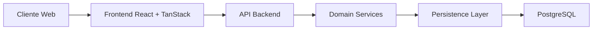
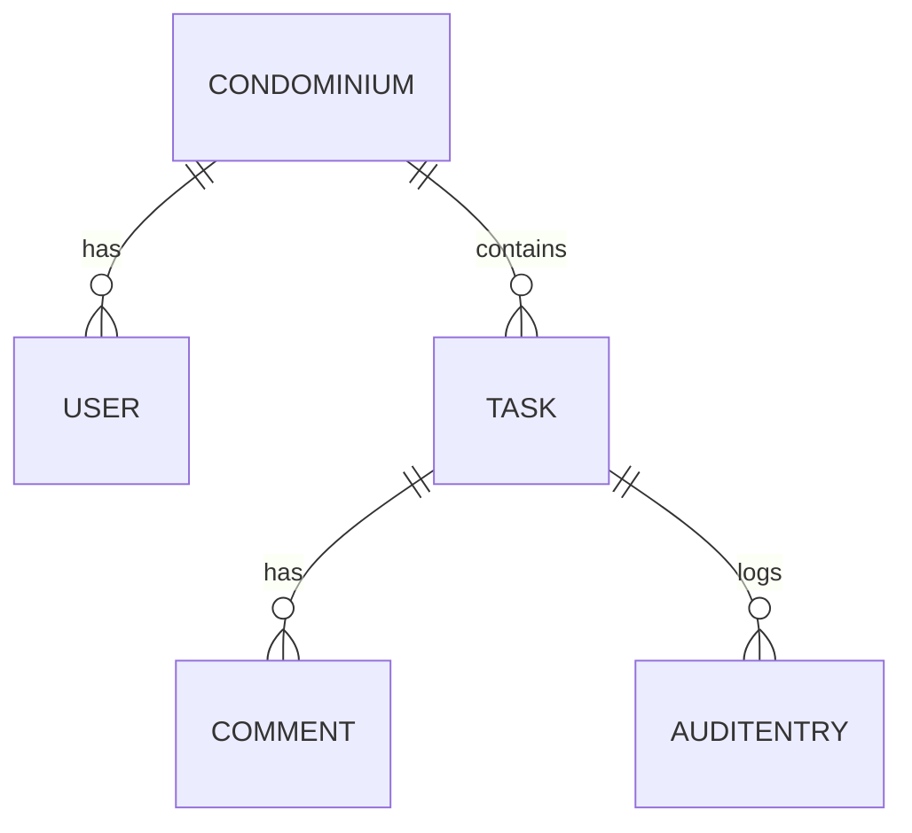

# Arquitetura – Burgoweb

## 1. Objetivo da arquitetura

A arquitetura do Burgoweb deve sustentar uma aplicação simples, confiável e evolutiva, com foco em organização, transparência e facilidade de uso para condomínios. A solução precisa permitir crescimento futuro sem sacrificar clareza, manutenção e qualidade de código.

## 2. Premissas de arquitetura

- o produto deve ser acessível e simples para usuários não técnicos;
- o código deve ser limpo, legível e fácil de evoluir;
- a arquitetura deve favorecer manutenção, testes e escalabilidade incremental;
- a interface deve seguir boas práticas modernas de UX e desenvolvimento frontend;
- o sistema deve ser preparado para crescer a partir de um núcleo simples.

## 3. Visão geral da solução

O Burgoweb será implementado como uma aplicação web moderna com separação clara entre frontend, domínio e integração de dados.

### Componentes principais

- Frontend web responsivo;
- API backend para regras de negócio e persistência;
- camada de dados e persistência;
- autenticação e autorização básica;
- camada de observabilidade e qualidade.

## 4. Stack recomendada

### Frontend
- React
- TypeScript
- Vite
- TanStack Query para gestão de dados assíncronos
- TanStack Router para navegação
- shadcn/ui para componentes de UI
- Radix UI como base dos primitivos acessíveis
- Tailwind CSS com CSS variables para design tokens
- clsx / tailwind-merge para composição de classes

### Backend
- Node.js com TypeScript
- NestJS ou Express com estrutura modular
- Prisma ORM (ou equivalente) para persistência
- PostgreSQL
- JWT ou sessão baseada em cookies para autenticação

### Qualidade e engenharia
- ESLint
- Prettier
- Husky
- Vitest
- Testing Library
- Cypress para testes E2E e testes de fluxo de usuário
- Playwright como alternativa complementar para validações específicas
- Docker para ambiente local

## 5. Arquitetura de alto nível



## 6. Arquitetura de frontend

A camada de interface deve ser organizada com base em componentes pequenos, reutilizáveis e com responsabilidade única.

### Diretrizes principais

- composição por UI, em vez de herança excessiva;
- componentes atômicos e compostos;
- separação entre apresentação, estado e regras de negócio;
- uso de hooks e adapters para isolamento de integração;
- uso de design tokens via CSS variables.

### Estrutura sugerida

```text
src/
  app/
    routes/
    layouts/
  components/
    ui/
    features/
    layouts/
  features/
    condominium/
    tasks/
    communications/
  lib/
    api/
    auth/
    utils/
    styles/
  domains/
    models/
    services/
    repositories/
  hooks/
  pages/
```

## 7. Princípios de programação orientada a objetos e código

### Clean Code
- nomes claros e expressivos;
- funções pequenas e bem focadas;
- evitar duplicação;
- código autoexplicativo;
- responsabilidades bem definidas.

### Object Calisthenics
- apenas uma responsabilidade por método ou classe;
- evitar abreviações excessivas;
- não expor atributos mutáveis sem necessidade;
- manter objetos pequenos e coesos.

### SOLID
- Single Responsibility Principle: cada classe ou módulo tem uma responsabilidade bem delimitada;
- Open/Closed Principle: extensibilidade por composição e abstração;
- Liskov Substitution Principle: contratos claros e substituíveis;
- Interface Segregation Principle: interfaces pequenas e específicas;
- Dependency Inversion Principle: dependência de abstrações e não de implementações concretas.

### Lei de Demeter
- evitar longas cadeias de chamadas;
- encapsular colaboração entre objetos;
- favorecer métodos simples e fáceis de entender.

### Composição para UI
- componentes compostos reutilizáveis;
- composição de blocos pequenos em vez de hierarquias rígidas;
- estratégia preferencial para construir interfaces complexas sem acoplamento.

## 8. Padrões de projeto recomendados

### 1. Repository Pattern
- isolar acesso a dados e persistência;
- separar infraestrutura de domínio.

### 2. Service Layer
- concentrar regras de negócio em serviços específicos;
- manter controladores e componentes simples.

### 3. Factory / Builder
- facilitar criação de objetos complexos, como formulários e entidades de domínio.

### 4. Strategy Pattern
- permitir variações de comportamento, por exemplo, diferentes formas de autenticação ou regras de status.

### 5. Observer / Event-driven hooks
- para notificações, sincronização e atualização reativa de interfaces.

## 9. Modelagem de domínio

Entidades principais:

- Condominium
- User
- Task
- Comment
- AuditEntry
- Permission

### Exemplo de relação conceitual



## 10. Backend e regras de negócio

A camada de backend deve concentrar:

- autenticação e autorização;
- validação de regras;
- persistência de entidades;
- fluxo de operações de tarefas e comunicação;
- auditoria de mudanças.

### Recomendações

- manter os controladores finos;
- colocar regras complexas em services;
- usar DTOs para representar entrada e saída;
- validar tudo na camada apropriada;
- registrar eventos de auditoria para mudanças importantes.

## 11. Frontend e UI

### Biblioteca de UI
- shadcn/ui será a base para componentes de interface;
- Radix UI fornecerá comportamento acessível e primitivos robustos;
- Tailwind CSS e CSS variables garantir consistência visual e personalização.

### Padrões de UI

- componentes reutilizáveis com props bem definidas;
- estado local quando necessário e estado compartilhado quando relevante;
- hooks para buscar e transformar dados;
- queries e mutations com TanStack Query;
- identificação e extração de padrões repetitivos para componentização contínua.

### Estratégia de componentização e framework embrionário

Durante o desenvolvimento, todo elemento repetível, padrão de interface ou regra de composição que tiver potencial de reutilização deve ser identificado e encapsulado em componentes ou blocos de abstração.

Essa prática deve gerar um embrião de framework interno, composto por:

- componentes base reutilizáveis;
- padrões de layout e composição;
- regras de acessibilidade e consistência visual;
- helpers e abstrações de integração.

Esse framework interno não precisa ser completo desde o início, mas deve crescer de forma intencional ao longo do projeto, com foco em padronizar a construção de interfaces e reduzir retrabalho.

## 12. Estratégia de estado

### Frontend
- estado local para UI simples;
- TanStack Query para dados remotos e cache;
- contexto ou store quando necessário para estado global leve.

### Backend
- estado persistido em banco relacional;
- auditoria e histórico em tabelas específicas.

## 13. Segurança

- autenticação obrigatória para áreas restritas;
- autorização baseada em papéis e permissões;
- validação de entrada em frontend e backend;
- proteção contra ataques comuns de web;
- uso de variáveis de ambiente para segredos;
- implementação de autenticação com Argon2id + pepper como padrão obrigatório;
- armazenamento seguro de segredos e uso de estratégias de rotação e proteção de chaves.

## 14. Testes

### Estratégia recomendada
- testes unitários para serviços e regras de domínio;
- testes de componentes para UI;
- testes de integração para API;
- testes E2E para fluxos principais com Cypress;
- validação contínua de componentes reutilizáveis e fluxos críticos.

## 15. Estratégia de evolução

A arquitetura deve permitir evolução incremental:

1. MVP com funcionalidades básicas de condomínio, pendências e histórico;
2. expansão para comunicação mais rica;
3. introdução de módulos adicionais sem reescrever o sistema.

## 16. Decisão arquitetural resumida

A solução recomendada é uma aplicação web moderna com frontend React + TypeScript, backend em Node.js + TypeScript, banco relacional e uma arquitetura modular orientada a domínios, com forte uso de composição para UI, padrões SOLID, Clean Code e bibliotecas modernas como TanStack, shadcn/ui, Radix e Tailwind.
