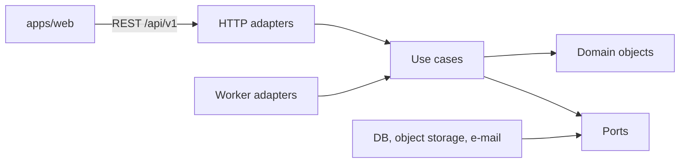
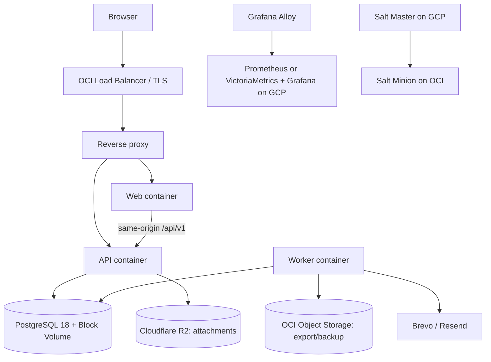
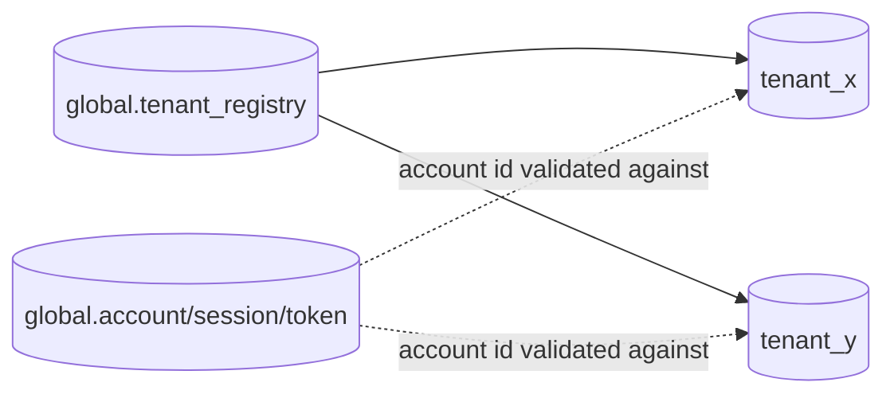

# Architecture Spine — Burgoweb

## Design Paradigm

O Burgoweb é greenfield dentro do repositório atual. Frontend e backend são aplicações separadas em um monorepo; o backend é um monólito modular em camadas, organizado por funcionalidade. Cada módulo contém entrega HTTP, casos de uso, modelo de domínio seletivo e adapters. Casos de uso só dependem de ports; adapters dependem dos casos de uso e implementam os ports. DDD tático não é obrigatório.



## Invariants & Rules

### AD-1 — Fronteiras do monorepo [ADOPTED]

- **Binds:** web, API, worker e CI.
- **Prevents:** acoplamento de implementação entre UI, negócio e persistência.
- **Rule:** `apps/web` consome somente o contrato HTTP gerado; não importa módulos do backend, tipos Kysely nem classes de domínio. `apps/api` e `apps/worker` compartilham casos de uso/adapters internos, mas têm entrypoints e processos independentes. Exports públicos de pacote, regra de imports/ciclos e CI fazem enforcement; somente os composition roots de API/worker importam adapters concretos.

### AD-2 — Monólito modular sem DDD cerimonial [ADOPTED]

- **Binds:** todos os módulos de negócio.
- **Prevents:** regras em controllers e adoção universal de agregados, repositórios ou eventos sem necessidade.
- **Rule:** módulos são verticais por funcionalidade; controllers apenas validam/traduzem e chamam um caso de uso. Objetos de domínio são criados somente para proteger invariantes reais. SOLID, composição sobre herança, Lei de Demeter e código limpo orientam o desenho sem metas artificiais de Object Calisthenics.

### AD-3 — REST como única fronteira pública [ADOPTED]

- **Binds:** FR-1..FR-45, web, API e integrações futuras.
- **Prevents:** contratos duplicados, GraphQL prematuro e dependência do frontend em código servidor.
- **Rule:** a API expõe JSON em `/api/v1`; DTOs NestJS geram OpenAPI validado no CI e o cliente TypeScript é regenerado desse contrato. Entradas têm validação runtime, erros seguem RFC 9457, mudanças compatíveis são aditivas e breaking changes criam nova versão.

### AD-4 — Tenant informado não é tenant autorizado [ADOPTED]

- **Binds:** toda operação tenant-scoped, FR-5, NFR-6 e NFR-7.
- **Prevents:** acesso cruzado por adulteração de URL, header ou payload.
- **Rule:** o cliente envia programaticamente o ID público do Condomínio selecionado. A API resolve esse ID no registro global, valida Conta, Vínculo ativo e capacidade e cria um `TenantContext` imutável e não construível por input, contendo tenant interno e schema confiável. Casos de uso, repositories e transactions tenant-scoped aceitam somente esse contexto, nunca ID/schema cru. Jobs carregam tenant opaco, re-resolvem o contexto e revalidam estado antes de executar. O nome do schema nunca entra nem sai do contrato HTTP.

### AD-5 — Um schema PostgreSQL por Condomínio [ADOPTED]

- **Binds:** todos os dados institucionais, FR-5, NFR-6 e NFR-7.
- **Prevents:** mistura física de dados e troca de `search_path` vazando pelo pool.
- **Rule:** o schema global possui Conta, credencial, sessão, tokens, registro de tenants e índices mínimos de roteamento; cada schema tenant possui Pessoas, Unidades, Vínculos, capacidades, conteúdo, finanças, auditoria e outbox. Consultas usam `withSchema` ou nomes qualificados; `SET LOCAL search_path` só é permitido dentro de transação controlada.

### AD-6 — Kysely é o único acesso ao banco [ADOPTED]

- **Binds:** persistência global e tenant.
- **Prevents:** dois pools, duas syntaxes, duas gerações de tipos e dependência de engine ORM.
- **Rule:** todo SQL de aplicação passa por Kysely ou migration SQL versionada. `kysely-codegen` gera tipos a partir do schema global e de um schema tenant canônico; tipos gerados não atravessam a fronteira da API. Prisma não integra o baseline.

### AD-7 — Migrations globais e tenant são retomáveis [ADOPTED]

- **Binds:** provisionamento, deploy, restauração e NFR-18.
- **Prevents:** drift de schemas e rollout que indisponibiliza todos os tenants.
- **Rule:** migrations ficam separadas em `global` e `tenant`; cada schema registra sua versão. O executor percorre tenants ativos em lotes, registra estado, pode retomar e aplica expand/contract. Provisionamento só ativa um tenant após migrá-lo à versão compatível com a aplicação.

### AD-8 — Autorização é granular e deny-by-default [ADOPTED]

- **Binds:** FR-8, FR-9, FR-19, FR-20, FR-34, FR-41, FR-42 e NFR-6.
- **Prevents:** perfis amplos concedendo acesso implícito e autoelevação de privilégio.
- **Rule:** capacidades são verificadas por ação e recurso no caso de uso; ausência ou estado desconhecido nega. Mutações privilegiadas revalidam Vínculo, vigência, capacidade e versão dentro da mesma transação da escrita, com lock ou comparação de versão; leituras/jobs longos revalidam no início e na entrega. Gerenciar responsáveis financeiros exige capacidade própria, distinta de gerenciar vínculos, e atribuição/remoção gera auditoria e notificação ao afetado. Nenhum usuário concede capacidade superior à sua autoridade delegável.

### AD-9 — Sessão opaca e revogável [ADOPTED]

- **Binds:** autenticação, FR-4, FR-33 e NFR-8.
- **Prevents:** identidade confiada ao browser, token duradouro e acesso após revogação.
- **Rule:** o browser recebe apenas token aleatório em cookie `__Host-`, `Secure`, `HttpOnly`, `SameSite=Lax`, `Path=/`; o schema global guarda seu hash. A sessão rotaciona após login, recuperação e mudança de privilégio e é revogável por sessão ou Conta; suspensão de Vínculo bloqueia imediatamente somente aquele tenant. Recuperação consumida invalida tokens anteriores e permite encerrar as demais sessões. TTL absoluto/ocioso, rate limits por finalidade e respostas sem enumeração são obrigatórios. Mutações exigem token CSRF, validação de Origin/Referer e Fetch Metadata; GET nunca muta e o baseline não habilita CORS.

### AD-10 — Credenciais e tokens têm finalidade isolada [ADOPTED]

- **Binds:** FR-4, FR-7, FR-33 e NFR-8.
- **Prevents:** comprometimento conjunto de banco e segredo, replay e confusão entre fluxos.
- **Rule:** senhas usam Argon2id com salt individual e pepper versionado no OCI Vault, parâmetros medidos nunca abaixo do baseline OWASP vigente e rehash progressivo. Convite, verificação e recuperação usam tokens distintos, aleatórios, de uso único, com expiração e somente hash persistido.

### AD-11 — Toda mutação é uma transação observável [ADOPTED]

- **Binds:** todos os casos de uso mutáveis, FR-45, NFR-9 e NFR-14.
- **Prevents:** dual write, auditoria parcial e perda silenciosa de trabalho assíncrono.
- **Rule:** o caso de uso grava estado e, quando exigidos por FR-45 ou por efeito assíncrono, Evento de Auditoria e item de outbox na mesma transação PostgreSQL. Outbox não é criado para mutação sem efeito assíncrono. Registros editáveis usam `version`; conflito otimista retorna 409. A API aceita `Idempotency-Key` nas mutações repetíveis definidas pelo contrato, vinculando tenant, Conta, operação, chave e hash da requisição.

### AD-12 — Publicação cria versão imutável [ADOPTED]

- **Binds:** FR-27..FR-29, FR-34..FR-36, FR-43 e FR-44.
- **Prevents:** alteração retroativa do que foi comunicado ou aprovado.
- **Rule:** publicação referencia snapshot imutável do conteúdo e de seus anexos compartilháveis. Correção cria nova versão ligada à anterior. Até a política jurídica permitir expurgo, fluxo de produto não apaga fisicamente objeto publicado: suspensão muda disponibilidade, sem mudar snapshot/hash; incidente pode registrar indisponibilidade auditada. Expurgo permitido deixa tombstone, hash e razão. A interface distingue rascunho, publicado, suspenso, substituído e removido e nunca republica automaticamente após suspensão.

### AD-13 — Anexos privados usam quarentena e objetos imutáveis [ADOPTED]

- **Binds:** FR-14, FR-35, FR-37, NFR-1, NFR-6 e NFR-8.
- **Prevents:** proxy de binários pela VM, objeto órfão utilizável e exposição acidental do original.
- **Rule:** R2 é privado, sem listagem; a API gera chave opaca e URL curta vinculada a método/chave e, quando suportado, tamanho/checksum. Promoção confirma tamanho/hash no provedor, detecta tipo por conteúdo, aplica allowlist e scanner/sanitizador; falha ou timeout permanece em quarentena. Original e versão compartilhável são objetos separados e imutáveis. Download usa domínio sem cookie da aplicação, URL curta, tipo seguro e `Content-Disposition: attachment`. Lifecycle remove quarentenas abandonadas/infectadas, nunca objetos publicados retidos.

### AD-14 — Leituras sensíveis são auditadas e minimizadas [ADOPTED]

- **Binds:** LGPD, FR-19, FR-24..FR-26, FR-30, FR-33, FR-45, NFR-1, NFR-3 e NFR-9.
- **Prevents:** consulta invisível de dados pessoais ou reexposição de conteúdo moderado.
- **Rule:** são auditados acesso a inadimplência detalhada, original de anexo, original moderado, payload de solicitação LGPD, exportação/download e mudanças de segurança ou capacidade. O evento registra ator, tenant, ação, alvo, finalidade/contexto, resultado, instante e correlação, sem copiar o conteúdo sensível. Original moderado exige capacidade excepcional de incidente de segurança/privacidade e sempre gera auditoria.

### AD-15 — Auditoria é append-only para a aplicação [ADOPTED]

- **Binds:** FR-45 e NFR-9.
- **Prevents:** usuário ou fluxo comum apagando evidência e logs técnicos substituindo trilha de negócio.
- **Rule:** Eventos de Auditoria são inseridos por função/role restrita e port dedicado, com campos de ator/correlação preenchidos pelo servidor; processos comuns não possuem SELECT/UPDATE/DELETE direto. Consultas passam por caso de uso, capacidade própria e projeção minimizada. Isso protege contra fluxos normais, não contra administrador PostgreSQL. Correções geram evento compensatório; gaps de sequência/correlação são monitorados.

### AD-16 — Dinheiro e tempo não usam representações ambíguas [ADOPTED]

- **Binds:** FR-10..FR-13, FR-38..FR-40 e contratos financeiros.
- **Prevents:** erro binário de centavos e mudança de data por fuso.
- **Rule:** dinheiro usa `numeric(19,2)`, biblioteca decimal e string decimal no JSON, nunca `number` JavaScript. Instantes usam `timestamptz` em UTC; datas civis usam `date`; cada Condomínio define timezone IANA. IDs públicos são opacos e não sequenciais.

### AD-17 — Fila inicial é PostgreSQL [ADOPTED]

- **Binds:** e-mail, convites, exportações, notificações e tarefas demoradas.
- **Prevents:** Redis prematuro, processamento duplicado não controlado e trabalho perdido.
- **Rule:** worker separado, usando a imagem/código do backend, consome outbox com `FOR UPDATE SKIP LOCKED`, lease, tentativas limitadas, backoff e dead-letter. Handlers são idempotentes. Redis/BullMQ só entram após evidência registrada de throughput ou scheduling que o PostgreSQL não atenda.

### AD-18 — Exportação é autocontida, íntegra e efêmera [ADOPTED]

- **Binds:** FR-24..FR-26 e portabilidade.
- **Prevents:** pacote ilegível, incompleto, público ou dependente do fornecedor.
- **Rule:** o pedido fixa finalidade, tipo, período e escopo. O job revalida capacidade específica e `TenantContext`; a entrega revalida novamente e registra uso. ZIP64 versionado contém `manifest.json`, JSON UTF-8 canônico, CSV e apenas binários que o solicitante pode ler; original moderado exige capacidade excepcional e finalidade jurídica. O manifesto traz versão, escopo, contagens, exclusões e SHA-256. Artefato privado/criptografado em repouso usa URL curtíssima revogável, não enviada por e-mail, e expira.

### AD-19 — Backup e restauração são duas capacidades [ADOPTED]

- **Binds:** NFR-15, NFR-16, NFR-18 e continuidade.
- **Prevents:** confundir dump por tenant com recuperação de desastre.
- **Rule:** PostgreSQL usa backup físico mais WAL/PITR e dumps lógicos por schema. Artefatos usam TLS, criptografia em repouso, checksums autenticados, retenção imutável quando disponível e credenciais separadas para escrita, retenção e restauração; temporários não ficam desprotegidos. Restore ocorre em destino novo, confirma tenant/schema antes de promoção e testa também indisponibilidade da VM/compartimento OCI. Restauração integral, seletiva e reprovisionamento são gates.

### AD-20 — Baseline gratuito é single-node, não HA [ADOPTED]

- **Binds:** implantação, NFR-16..NFR-20.
- **Prevents:** custo de control plane, alegação falsa de alta disponibilidade e dependência de Aiven.
- **Rule:** o OCI Load Balancer é o único endpoint público e termina TLS; encaminha somente ao reverse proxy privado, que roteia web/API, remove headers `Forwarded` externos, confia apenas no hop do LB, aplica HSTS/headers/limites/timeouts e expõe health checks. Uma OCI A1 ARM64 (2 OCPU/12 GB) executa por Docker Compose proxy, web, API, worker e PostgreSQL 18 em Block Volume. Imagens suportam `linux/arm64`. Nenhum documento ou SLO chama esse ambiente de HA.

### AD-21 — Salt configura; Prometheus/Grafana observam [ADOPTED]

- **Binds:** hosts, deploy, telemetria e resposta operacional.
- **Prevents:** ownership sobreposto e OpenSearch excedendo o envelope gratuito.
- **Rule:** Salt Master em GCP governa o Minion OCI somente por túnel privado/VPN, firewall deny-by-default, chaves aceitas explicitamente e rotacionáveis; interfaces administrativas exigem MFA e contas separadas. Alloy exporta métricas sem dados pessoais por canal autenticado/privado. Prometheus e Grafana rodam na GCP, com VictoriaMetrics se o soak reprovar Prometheus. Logs JSON têm rotação/correlação; auditoria é separada. Logs centralizados e traces não integram o baseline.

### AD-22 — Integrações externas ficam atrás de ports [ADOPTED]

- **Binds:** R2, OCI Object Storage, Brevo, Resend e futuros provedores.
- **Prevents:** lock-in e troca de provedor alterando casos de uso.
- **Rule:** adapters implementam `ObjectStoragePort`, `BackupStoragePort` e `EmailPort`. E-mail sai exclusivamente pelo worker via HTTPS: Brevo é primário e Resend contingência; SPF/DKIM/DMARC são obrigatórios, webhooks são autenticados e tracking de abertura/clique permanece desabilitado.

### AD-23 — Configuração falha fechada [ADOPTED]

- **Binds:** todos os processos e ambientes, NFR-8 e NFR-10.
- **Prevents:** segredo em imagem/repositório e inicialização parcial insegura.
- **Rule:** configuração é validada e tipada no startup; ausência ou incoerência crítica impede subir. Segredos são fornecidos em runtime por Salt/OCI Vault, nunca entram no repositório, imagem, log ou OpenAPI. Cada processo e provedor recebe credenciais de menor privilégio. Convite, autenticação/recuperação, upload, download e exportação aplicam limites por Conta+tenant+operação e sinal de origem; IP nunca é a única chave, e quotas/alertas impedem abuso silencioso.

### AD-24 — Gate de release testa as fronteiras reais [ADOPTED]

- **Binds:** CI/CD, NFR-1..NFR-20.
- **Prevents:** mocks mascarando semântica de PostgreSQL e regressão entre tenants.
- **Rule:** Vitest cobre unidade/integração; persistência usa PostgreSQL 18 real via Testcontainers; Cypress cobre E2E. CI valida OpenAPI/cliente, imports/ciclos e exige isolamento em API/job/upload/download/export/migration, revogação concorrente, auth, idempotência, outbox, migrations e storage hostil/S3-compatible. Fluxos críticos testam teclado, foco e viewports; auditor automatizado de acessibilidade complementa revisão humana. Benchmark OCI, soak GCP, retenção/egress e restores são gates.

### AD-25 — Provisionamento e contenção preservam autoridade [ADOPTED]

- **Binds:** FR-3, FR-28..FR-33 e FR-37.
- **Prevents:** tenant parcialmente ativo, recuperação transferindo papel e suspensão republicando conteúdo.
- **Rule:** criação Conta+Condomínio+autoridade inicial é workflow compensável com estados explícitos e só ativa após schema migrado; falha elimina ou coloca em quarentena recursos incompletos. Recuperação/contensão de Conta comprova controle mas nunca transfere Papel/capacidade. Suspensão preserva última versão segura sem republicação automática. Solicitação LGPD, disputa, SLA e cotas possuem máquina de estados, owner e auditoria no módulo `governance`.

### AD-26 — Acessibilidade é requisito de entrega [ADOPTED]

- **Binds:** experiência web e NFRs de acessibilidade/usabilidade.
- **Prevents:** UI aprovada apenas por aparência ou automação parcial.
- **Rule:** componentes seguem semântica HTML e WCAG 2.2 AA como baseline; fluxos críticos funcionam por teclado, preservam foco, têm contraste e linguagem verificáveis em mobile/desktop. Automação sinaliza regressões, mas aceite inclui revisão humana.

## Consistency Conventions

| Concern | Convention |
| --- | --- |
| Módulos e nomes | Pastas e código em inglês; módulos por capability; `*UseCase`, `*Port`, `*Adapter`; eventos no passado e versionados. |
| Contratos | JSON camelCase; banco snake_case; IDs opacos; RFC 9457; `X-Request-Id`; paginação por cursor onde o conjunto puder crescer. |
| Estado | Mutação somente por caso de uso e transação; sem estado de negócio na web, proxy ou memória do processo. |
| Segurança | Deny-by-default; tenant, ator e capacidade vêm de contexto validado; saída minimizada; conteúdo privado não é cacheado. |
| Observabilidade | Logs estruturados com correlação, métricas de RED/USE e alertas acionáveis; nunca incluir senha, token, cookie ou payload pessoal. |
| Dependências | Versões exatas no lockfile/imagens por digest; atualização é PR explícito com testes e migration review. |

## Stack

| Name | Version |
| --- | --- |
| TypeScript | 7.0.2; compatibilidade integra o spike de bootstrap |
| Node.js | 24.18.0 LTS |
| React | 19.2.7 |
| TanStack React Start / Router | 1.168.30 / 1.168.30, canal RC |
| Vite | 8.1.5 |
| NestJS / platform-fastify | 11.1.20 / 11.1.20 |
| Fastify | 5.10.0 |
| PostgreSQL | 18.4 |
| Kysely / kysely-codegen | 0.29.2 / 0.20.0 |
| Vitest | 4.1.10 |
| Cypress | 15.19.0 |
| Testcontainers for Node.js | 12.0.4 |
| Docker Engine | 29.6.2 |
| Docker Compose plugin | 5.1.4 |
| Salt Project | 3008 LTS; patch do repositório fixado no baseline operacional |
| Prometheus | 3.13.0 LTS |
| Grafana | 13.1 |
| Grafana Alloy | 1.18 |

## Structural Seed

```text
burgoweb/
  apps/
    web/                 # TanStack Start; UI e cliente gerado
    api/                 # NestJS HTTP entrypoint
    worker/              # entrypoint assíncrono
  packages/
    application/         # módulos, casos de uso, ports e domínio seletivo
    adapters/            # Kysely, storage, e-mail e telemetria
    api-client/          # gerado de OpenAPI; único contrato consumido pela web
    config/              # schemas de configuração compartilhados pelo servidor
    test-support/        # fixtures/builders sem regras de produção
  migrations/
    global/
    tenant/
  infra/
    compose/
    salt/
    observability/
```





## Capability → Architecture Map

| Capability / Area | Lives in | Governed by |
| --- | --- | --- |
| Conta, autenticação e recuperação | `application/identity`, global schema | AD-9, AD-10, AD-23 |
| Condomínio, Pessoas, Unidades e Vínculos | `application/tenancy`, tenant schema | AD-4, AD-5, AD-8 |
| Provisionamento Conta + Condomínio | `application/provisioning`, global + tenant | AD-7, AD-25 |
| Documentos, avisos, assembleias e projetos | módulos tenant correspondentes | AD-11, AD-12, AD-13 |
| Financeiro e prestações de contas | `application/finance` | AD-8, AD-16 |
| Mensagens e notificações | `application/messaging`, worker | AD-17, AD-22 |
| Suspensão, disputa, contenção, LGPD, SLA e cotas | `application/governance`, worker | AD-12, AD-14, AD-25 |
| Auditoria e exportação | `application/governance`, worker | AD-14, AD-15, AD-18 |
| Acessibilidade e clientes suportados | `apps/web`, design system e E2E | AD-24, AD-26 |
| Persistência e migrations | `adapters/db`, `migrations` | AD-5, AD-6, AD-7 |
| Operação e continuidade | `infra` | AD-19, AD-20, AD-21, AD-24 |

## Deferred

- Duração final de retenção por classe, hipótese de eliminação física e prazo de acesso ao original moderado: fecha no gate jurídico/LGPD antes do lançamento; histórias de expurgo permanecem bloqueadas e AD-12 governa o comportamento até lá.
- Criptografia adicional do ZIP de exportação e canal de entrega de chave: fecha por threat model e teste de recuperabilidade; armazenamento privado, TLS e expiração são obrigatórios desde o início.
- Prometheus versus VictoriaMetrics: o soak test da e2-micro decide sem alterar contratos de telemetria.
- Produto do reverse proxy: seleção durante bootstrap sem alterar a topologia e os controles fixados em AD-20.
- Objetivos numéricos de desempenho, capacidade e recuperação: só serão promovidos a SLO depois de benchmark e exercícios de restore; até lá valem os gates do PRD.
- Redis/BullMQ, logs centralizados, tracing distribuído, K3s/Kubernetes e HA: fora do baseline; somente decisão nova baseada em necessidade medida.
