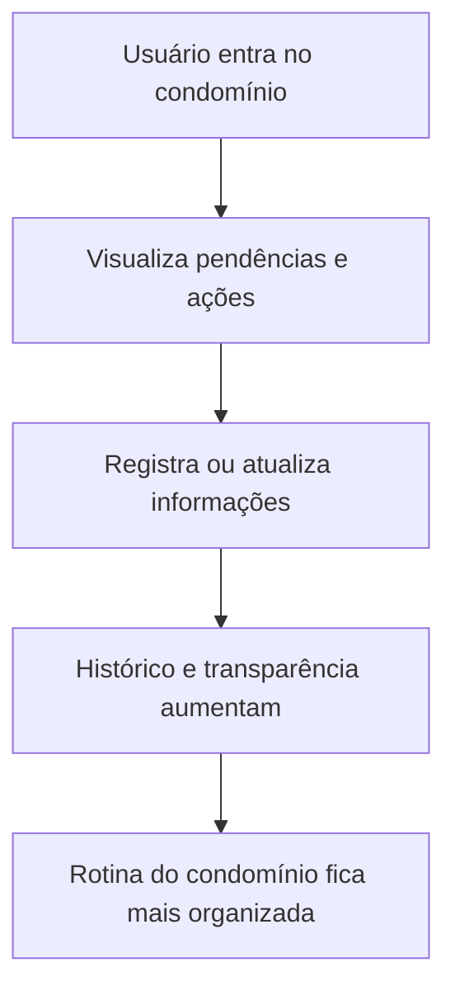

# PRD – Burgoweb

## 1. Objetivo do produto

O Burgoweb tem como objetivo oferecer uma plataforma simples, gratuita e confiável para condomínios que precisam organizar sua rotina, melhorar a transparência e reduzir o caos operacional sem depender de sistemas complexos.

## 2. Problema a resolver

Condomínios pequenos e médios frequentemente enfrentam problemas de:

- comunicação dispersa;
- falta de rastreio de pendências;
- ausência de histórico claro de decisões e ações;
- dependência de processos improvisados.

Esses problemas dificultam a operação diária e geram atrito entre síndicos, moradores e administradores.

## 3. Proposta de valor

O Burgoweb deve permitir que o condomínio tenha uma visão mais clara da sua rotina, com informações organizadas e ações acompanhadas de forma simples.

O valor central está em:

- reduzir a perda de informação;
- aumentar a transparência;
- facilitar o acompanhamento de pendências;
- oferecer uma solução acessível e fácil de usar.

## 4. Público-alvo

### Usuários principais
- síndicos;
- administradores informais;
- pequenos times operacionais do condomínio.

### Usuários secundários
- moradores interessados em acompanhar ações e decisões.

## 5. Requisitos de alto nível

### 5.1 Funcionalidades essenciais

O produto deve permitir:

- criar e acessar um condomínio;
- registrar pendências e atribuir responsáveis;
- acompanhar status de tarefas;
- manter histórico de ações e decisões;
- facilitar comunicação interna básica.

### 5.2 Requisitos de experiência

- interface simples e intuitiva;
- navegação clara para usuários com baixa familiaridade tecnológica;
- experiência confiável mesmo em uso ocasional.

### 5.3 Requisitos de negócio

- proposta gratuita no núcleo;
- foco em simplicidade e adoção;
- evolução gradual a partir do uso real.

## 6. Escopo inicial

### Incluído
- cadastro de condomínio;
- registro de pendências;
- acompanhamento de responsabilidades;
- histórico de ações;
- comunicação básica e transparência operacional.

### Excluído no primeiro ciclo
- gestão financeira completa;
- automações avançadas;
- módulos muito especializados;
- recursos complexos de integração.

## 7. Critérios de sucesso

O produto será considerado bem-sucedido se:

- os usuários conseguirem organizar pendências com menos esforço;
- a comunicação se tornar mais transparente;
- os responsáveis por ações tiverem maior clareza sobre suas atribuições;
- a adoção for positiva entre condomínios pequenos e médios.

## 8. Regras de produto

- priorizar simplicidade sobre funcionalidade excessiva;
- evitar sobrecarregar a experiência inicial;
- manter o foco na transparência e organização do cotidiano;
- não transformar o produto em um sistema complexo desde o início.

## 9. Hipóteses a validar

- usuários aceitam uma ferramenta simples em vez de uma plataforma completa;
- a proposta gratuita é um diferencial real de adoção;
- o histórico e a transparência são percebidos como benefícios concretos;
- a experiência precisa ser mais acessível do que ferramentas tradicionais de gestão.

## 10. Fluxo principal de valor

## 11. Próximos passos

A partir deste PRD, a próxima etapa natural é definir a experiência do usuário e a estrutura de informação, preparando a entrada para UX e arquitetura.
