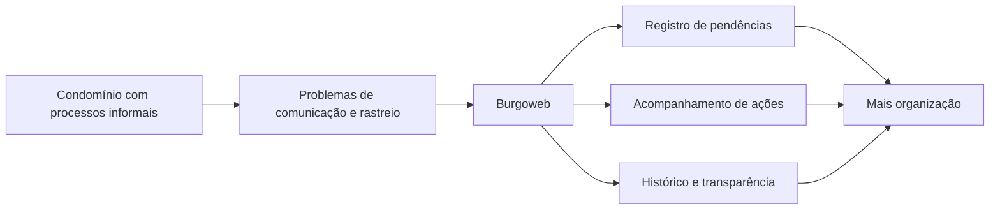

# Product Brief – Burgoweb

## Visão resumida

O Burgoweb é uma plataforma gratuita de organização e transparência para condomínios que não possuem estrutura administrativa forte nem um sistema de gestão consolidado. A proposta é reduzir o caos operacional com uma solução simples, confiável e fácil de usar.

## Contexto do projeto

Muitos condomínios operam com processos informais, comunicação dispersa e pouca rastreabilidade das pendências. Informações importantes acabam espalhadas em mensagens, planilhas, papel ou memória de quem participa da rotina.

Essa falta de organização gera retrabalho, ruído na comunicação e insegurança sobre o que foi decidido e quem é responsável por cada ação.

## Problema

Condomínios pequenos e médios enfrentam dificuldade para:

- manter comunicação clara entre síndicos, moradores e administradores;
- registrar e acompanhar pendências;
- preservar histórico de decisões e ações;
- reduzir dependência de processos improvisados.

## Proposta de valor

O Burgoweb oferece uma base simples para que condomínios organizem sua rotina com mais clareza e transparência. O foco está em ajudar o usuário a resolver problemas reais do dia a dia sem exigir uma curva de aprendizagem alta.

## Público-alvo

### Persona principal
- Síndicos ou administradores informais de condomínios pequenos ou médios.

### Persona secundária
- Moradores que precisam acompanhar decisões, demandas e ações de forma mais transparente.

## Necessidades centrais

- centralizar informações e comunicação;
- acompanhar pendências e responsáveis;
- manter um histórico claro de ações;
- reduzir a dependência de processos manuais e dispersos.

## Proposta inicial de solução

Criar um produto com foco em funcionalidades essenciais de organização e transparência, priorizando:

- cadastro e organização do condomínio;
- registro de pendências;
- acompanhamento de ações e responsáveis;
- histórico claro de decisões e atividades;
- interface simples e acessível.

## Princípios de produto

- gratuito no núcleo;
- simples de usar;
- confiável para o cotidiano;
- fácil de adotar mesmo sem estrutura administrativa formal;
- escalável apenas a partir de validações reais de uso.

## Escopo inicial

### Incluído
- organização básica do condomínio;
- registros de pendências;
- acompanhamento de ações;
- histórico de decisões e atividades;
- acesso simples para diferentes perfis.

### Excluído no primeiro ciclo
- gestão financeira complexa;
- automações avançadas;
- módulos altamente especializados;
- experiências excessivamente sofisticadas para a fase inicial.

## Critérios de sucesso

- redução do caos operacional no dia a dia;
- melhor clareza sobre pendências e responsabilidades;
- maior confiança em informações e decisões;
- adoção por condomínios que hoje não usam sistemas formais de gestão.

## Hipóteses a validar

- usuários preferem uma solução simples a uma plataforma completa;
- a proposta gratuita é um fator decisivo de adoção;
- transparência e histórico são percebidos como benefícios claros;
- a experiência precisa ser bem mais simples do que ferramentas tradicionais de gestão.

## Riscos principais

- escopo crescer além do necessário;
- complexidade excessiva reduzir a adoção;
- a proposta ser percebida como “mais uma ferramenta burocrática”; 
- falta de clareza sobre o que é essencial no primeiro ciclo.

## Fluxo de valor do usuário

## Conclusão

O Burgoweb deve ser tratado como uma solução inicial, prática e de alto valor para condomínios que precisam de ordem sem exigir complexidade. O foco principal é criar confiança, clareza e organização desde o primeiro uso.
