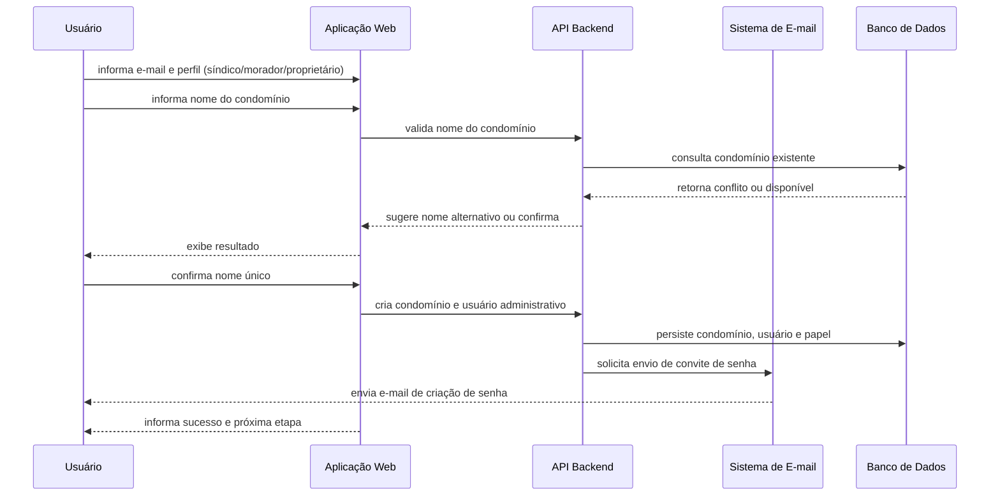
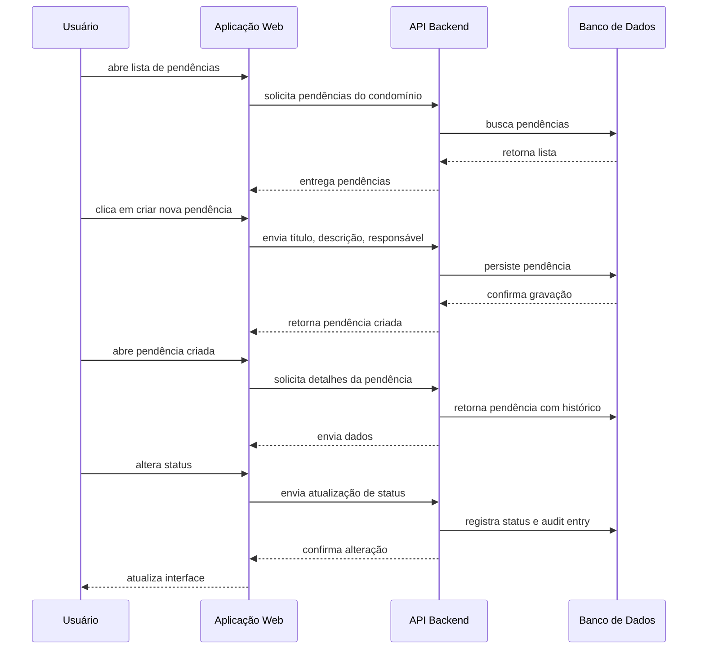
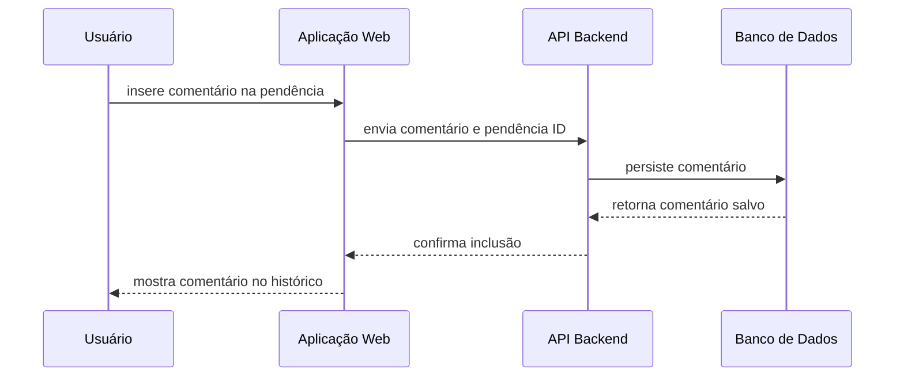
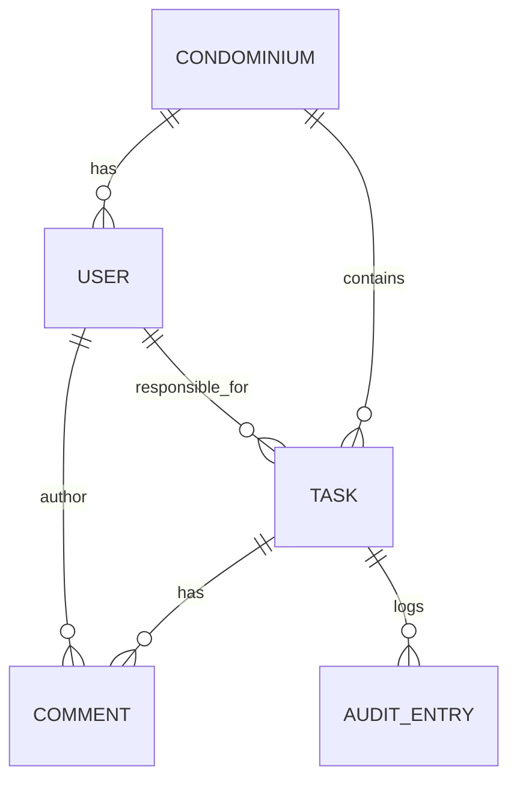
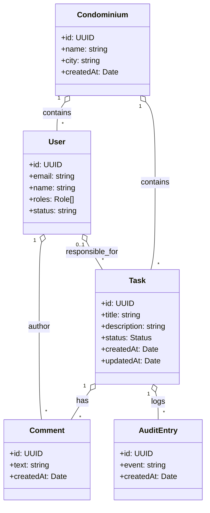
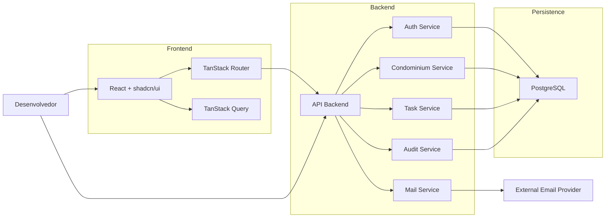
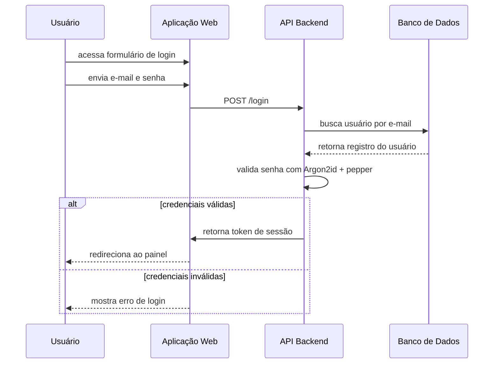
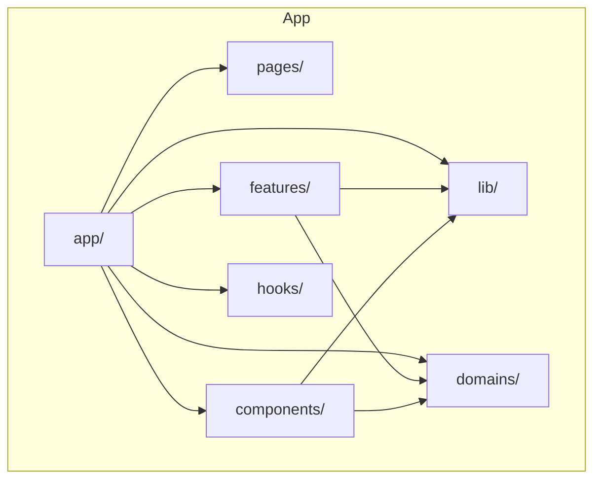

# Casos de Uso – Burgoweb

## 1. Visão geral

Este documento descreve os principais casos de uso do sistema, alinhados aos épicos e ao fluxo de onboarding do Burgoweb. Ele inclui diagramas Mermaid para representar o contexto do sistema, as interações de sequência e o modelo de domínio.

## 2. Atores

- **Administrador de Condomínio** — usuário que cria o condomínio e a conta administrativa. Pode ser síndico, morador, proprietário ou uma combinação deles.
- **Morador** — usuário que consulta pendências, histórico e participa das interações do condomínio.
- **Proprietário** — usuário com papel semelhante ao morador, mas com foco em gestão e acompanhamento de decisões.
- **Sistema de E-mail** — serviço externo usado para envio de convite de senha.
- **Desenvolvedor** — ator interno responsável por componentizar e reutilizar padrões de interface ao longo do desenvolvimento.

## 3. Casos de uso do sistema

### 3.1 Diagrama de casos de uso

```mermaid
usecaseDiagram
    actor Admin as "Administrador de Condomínio"
    actor Resident as "Morador"
    actor Owner as "Proprietário"
    actor Email as "Sistema de E-mail"
    actor Dev as "Desenvolvedor"

    Admin --> (Onboard Condomínio e Conta)
    Admin --> (Acessar Plataforma)
    Admin --> (Criar Pendência)
    Admin --> (Atribuir Responsável)
    Admin --> (Consultar Painel)

    Resident --> (Acessar Plataforma)
    Resident --> (Consultar Painel)
    Resident --> (Atualizar Status da Pendência)
    Resident --> (Comentar em Pendência)
    Resident --> (Consultar Histórico)

    Owner --> (Acessar Plataforma)
    Owner --> (Consultar Histórico)
    Owner --> (Consultar Painel)

    (Onboard Condomínio e Conta) .> Email : "envia convite de senha"
    Dev --> (Componentizar UI Reutilizável)
```

## 4. Casos de uso principais

### 4.1 Onboard Condomínio e Conta

- **Ator primário:** Administrador de Condomínio
- **Objetivo:** Criar o condomínio inicial e a conta administradora em um único fluxo.
- **Pré-condições:** o usuário ainda não possui conta no sistema.
- **Fluxo principal:**
  1. O usuário informa seu e-mail pessoal.
  2. O usuário seleciona o perfil: apenas síndico, apenas morador, morador e proprietário, ou morador, proprietário e síndico.
  3. O usuário informa o nome do condomínio.
  4. O sistema valida se o nome do condomínio já existe.
  5. Se existir conflito, o sistema sugere nomes alternativos ou permite que o usuário insira um novo nome único.
  6. O sistema cria o condomínio e a conta administrativa.
  7. O sistema envia um e-mail para definição de senha e liberação de acesso.
  8. O usuário define a senha e acessa a plataforma.

- **Fluxos alternativos:**
  - 4a. Se o nome do condomínio não for único, sugere `NOME_CONDOMÍNIO-CIDADE` ou permite novo nome.
  - 7a. Se o envio de e-mail falhar, o sistema exibe mensagem de erro e oferece reenvio.

### 4.2 Acessar Plataforma

- **Ator primário:** Administrador de Condomínio / Morador / Proprietário
- **Objetivo:** Autenticar-se e acessar o painel do condomínio.
- **Pré-condições:** o usuário já possui uma conta com senha definida.
- **Fluxo principal:**
  1. O usuário informa e-mail e senha.
  2. O sistema valida as credenciais usando Argon2id + pepper.
  3. O sistema gera token de sessão ou JWT e permite acesso.
  4. O usuário é redirecionado ao painel inicial.

- **Fluxos alternativos:**
  - 2a. Se as credenciais estiverem incorretas, o sistema exibe erro de login.
  - 2b. Se a conta não estiver ativada, o sistema orienta a verificar o e-mail.

### 4.3 Criar Pendência

- **Ator primário:** Administrador de Condomínio
- **Objetivo:** Registrar uma nova tarefa ou problema como pendência.
- **Pré-condições:** o usuário está autenticado e no contexto de um condomínio.
- **Fluxo principal:**
  1. O usuário acessa a área de pendências.
  2. O usuário preenche título, descrição e responsável.
  3. O usuário salva a pendência.
  4. O sistema persiste a pendência e a exibe na lista.

- **Fluxos alternativos:**
  - 2a. Se campos obrigatórios estiverem em branco, o sistema exibe validação.

### 4.4 Atribuir Responsável

- **Ator primário:** Administrador de Condomínio
- **Objetivo:** Definir quem responde pela pendência.
- **Pré-condições:** pendência criada e listado.
- **Fluxo principal:**
  1. O usuário abre a pendência.
  2. O usuário seleciona ou altera o responsável.
  3. O sistema salva a atribuição.
  4. A interface mostra o responsável atual.

### 4.5 Atualizar Status da Pendência

- **Ator primário:** Morador / Administrador de Condomínio
- **Objetivo:** Atualizar o progresso de uma pendência.
- **Pré-condições:** pendência criada e acessível.
- **Fluxo principal:**
  1. O usuário abre os detalhes da pendência.
  2. O usuário altera o status (por exemplo, aberto, em andamento, concluído).
  3. O usuário salva a mudança.
  4. O sistema registra a alteração no histórico.

### 4.6 Comentar em Pendência

- **Ator primário:** Morador / Proprietário / Administrador de Condomínio
- **Objetivo:** Registrar informações sobre a evolução da pendência.
- **Pré-condições:** pendência criada.
- **Fluxo principal:**
  1. O usuário abre a pendência.
  2. O usuário escreve um comentário ou atualização.
  3. O usuário salva o comentário.
  4. O sistema adiciona o comentário ao histórico.

### 4.7 Consultar Histórico

- **Ator primário:** Morador / Proprietário / Administrador de Condomínio
- **Objetivo:** Verificar o histórico de ações, comentários e mudanças.
- **Pré-condições:** há pelo menos uma ação registrada no condomínio.
- **Fluxo principal:**
  1. O usuário acessa a área de histórico ou detalhes da pendência.
  2. O usuário visualiza entradas de histórico ordenadas cronologicamente.
  3. O usuário encontra informações sobre decisões e atualizações anteriores.

### 4.8 Consultar Painel

- **Ator primário:** Administrador de Condomínio / Morador / Proprietário
- **Objetivo:** Obter visão rápida do estado atual do condomínio.
- **Pré-condições:** o usuário está autenticado.
- **Fluxo principal:**
  1. O usuário acessa o painel ou dashboard.
  2. O sistema exibe resumo de pendências, ações recentes e notificações importantes.
  3. O usuário navega para pendências ou histórico conforme necessário.

### 4.9 Componentizar UI Reutilizável

- **Ator primário:** Desenvolvedor
- **Objetivo:** Extrair padrões de interface repetidos em componentes reutilizáveis como base para um framework interno.
- **Pré-condições:** o sistema tem padrões de interface emergentes.
- **Fluxo principal:**
  1. O desenvolvedor identifica elementos de UI repetidos.
  2. O desenvolvedor extrai componentes atômicos e compostos.
  3. O sistema armazena componentes no repositório de UI (por exemplo, `src/components/ui`).
  4. O desenvolvedor reaproveita componentes em novas telas.

## 5. Diagramas de sequência

### 5.1 Sequência: Onboard Condomínio e Conta



### 5.2 Sequência: Criar Pendência e Atualizar Status



### 5.3 Sequência: Registrar Comentário em Pendência



## 6. Modelo de domínio e relações

### 6.1 Diagrama ER simplificado



### 6.2 Classe de domínio conceitual



## 7. Diagramas adicionais

### 7.1 Diagrama de componentes do sistema



### 7.2 Sequência detalhada: Login com e-mail e senha



### 7.3 Diagrama de pacotes/módulos do frontend



## 8. Considerações de avaliação

- o onboarding do condomínio é o fluxo mais crítico e merece priorização em testes e UX;
- o modelo de nomes únicos para condomínio deve ser validado com pesquisa de usuário e casos reais de duplicidade geográfica;
- os papéis flexíveis do usuário criador devem ser mantidos sem obrigar o usuário a entender distinções técnicas;
- o embrião de framework interno deve focar primeiro em padrões repetíveis de UI antes de se expandir para abstrações mais amplas.

## 9. Próximos artefatos UML recomendados

- Diagrama de componentes frontend/backend/persistência para alinhar implementadores;
- Diagrama de sequência detalhado para login e onboarding completo;
- Diagrama de pacotes ou módulos para a estrutura de `src/` se o projeto avançar para implementação.
