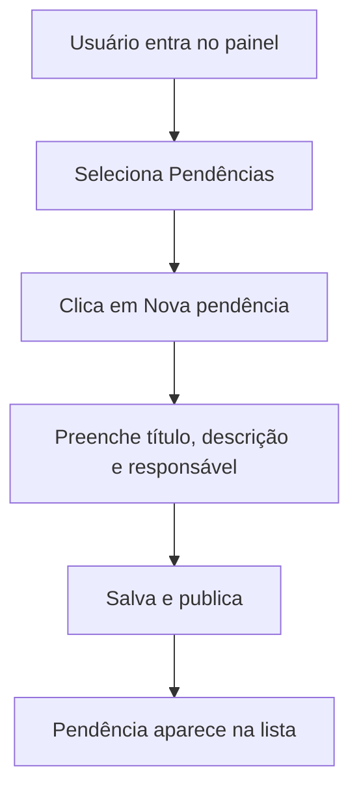
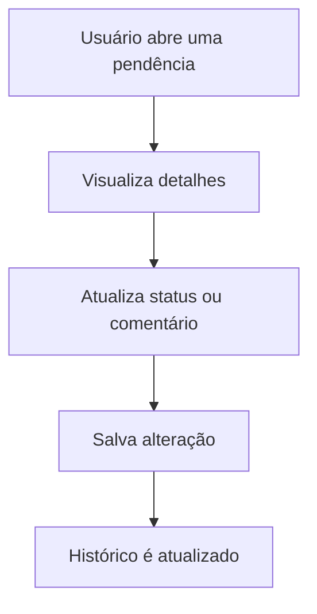
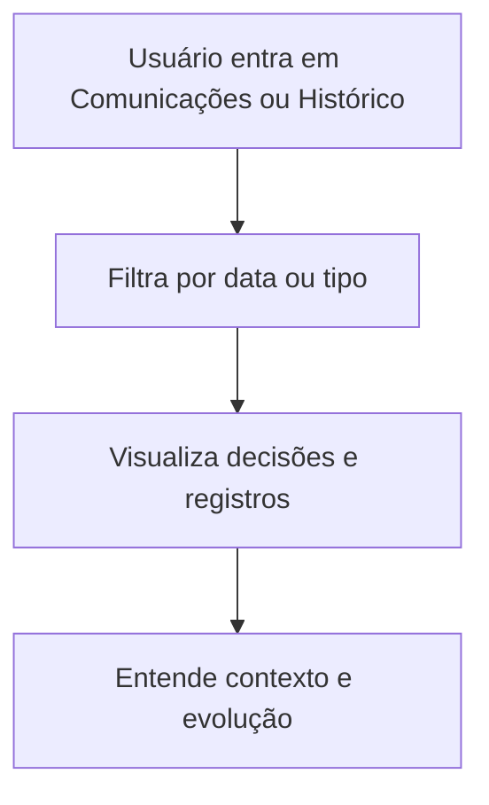

# UX Design – Burgoweb

## 1. Objetivo da experiência

A experiência do Burgoweb deve transmitir confiança, simplicidade e clareza. O usuário precisa sentir que consegue organizar a rotina do condomínio com pouco esforço, sem precisar aprender um sistema complexo.

## 2. Princípios de UX

- simplicidade acima de riqueza de recursos;
- clareza na navegação;
- linguagem acessível;
- foco em ações principais do dia a dia;
- sensação de transparência e controle.

## 3. Personas e contexto de uso

### Síndico ou administrador informal
- usa o sistema de forma ocasional;
- precisa resolver pendências rapidamente;
- valoriza organização e rastreabilidade.

### Morador
- quer acompanhar decisões e demandas;
- valoriza comunicação simples e transparente;
- não quer depender de processos improvisados.

## 4. Estrutura de informação proposta

A navegação deve ser simples, com foco em três grandes blocos:

1. Visão geral do condomínio
2. Pendências e ações
3. Histórico e comunicação

### Estrutura sugerida

- Home / Dashboard
  - resumo do condomínio
  - pendências abertas
  - ações recentes
- Pendências
  - listar itens
  - criar nova pendência
  - atribuir responsável
  - atualizar status
- Comunicações
  - registrar decisões
  - acompanhar histórico
- Perfil / Configuração
  - dados do condomínio
  - permissões básicas

## 5. Cenários principais

### Cenário 1: registrar uma pendência
O síndico precisa registrar uma questão pendente, como "reparar a porteira". O fluxo deve ser rápido e direto.

### Cenário 2: acompanhar uma ação
O usuário quer verificar se uma tarefa foi concluída, quem é o responsável e qual o status atual.

### Cenário 3: consultar o histórico
Um morador ou síndico precisa localizar decisões ou registros anteriores para entender o contexto de uma situação.

## 6. Fluxos principais

### Fluxo A – Criar pendência

### Fluxo B – Atualizar status

### Fluxo C – Consultar histórico

## 7. Diretrizes de interface

- usar linguagem simples e direta;
- destacar ações principais sem excesso de elementos;
- reduzir número de cliques para tarefas comuns;
- apresentar informação importante logo na tela inicial;
- manter consistência visual para aumentar confiança.

## 8. Critérios de usabilidade

A experiência será considerada boa se:

- o usuário consegue criar uma pendência em poucos passos;
- entender o estado de uma ação sem esforço;
- localizar decisões anteriores com facilidade;
- sentir que o sistema é simples e confiável.

## 9. Próximos passos

A partir deste documento, a próxima etapa natural é definir a arquitetura da informação e a estrutura técnica do sistema, preparando o caminho para a arquitetura do produto.
