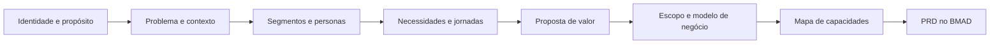
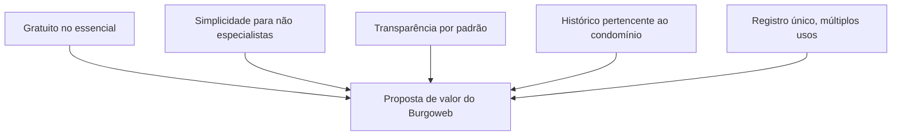

# Discovery do Burgoweb

## Objetivo

Este conjunto consolida a fase de ideação e discovery do Burgoweb: um produto web independente para organização, gestão e transparência de condomínios com pouca ou nenhuma estrutura administrativa.

O conteúdo foi estruturado para alimentar os workflows posteriores do BMAD no VS Code sem antecipar decisões de arquitetura, tecnologia ou implementação.

## Escopo do discovery

## Documentos

| Ordem | Documento | Pergunta respondida |
|---:|---|---|
| 01 | [Identidade e propósito](01-identidade-e-proposito.md) | Por que o Burgoweb deve existir? |
| 02 | [Problema e contexto](02-problema-e-contexto.md) | Qual realidade precisa ser transformada? |
| 03 | [Segmentos e personas](03-segmentos-e-personas.md) | Para quem o produto cria valor? |
| 04 | [Necessidades e jornadas](04-necessidades-e-jornadas.md) | Quais resultados e fluxos importam? |
| 05 | [Proposta de valor e diferenciação](05-proposta-de-valor-e-diferenciacao.md) | Por que alguém adotaria o produto? |
| 06 | [Escopo e modelo de negócio](06-escopo-e-modelo-de-negocio.md) | O que será gratuito, pago ou futuro? |
| 07 | [Mapa de capacidades](07-mapa-de-capacidades.md) | O que o produto deverá ser capaz de fazer? |
| 08 | [Decisões, hipóteses e riscos](08-decisoes-hipoteses-e-riscos.md) | O que está decidido e o que precisa ser validado? |
| 09 | [Handoff para BMAD](09-handoff-para-bmad.md) | Como continuar no VS Code? |
| 10 | [Referências](10-referencias.md) | Quais fontes sustentam as premissas? |

## Síntese executiva

O Burgoweb será uma plataforma gratuita de organização e transparência condominial, voltada inicialmente a condomínios que ainda dependem de cadernos, planilhas, mensagens e arquivos dispersos.

Seu valor central não será oferecer o maior número de módulos, mas combinar:

## Estado das decisões

| Tema | Estado |
|---|---|
| Nome Burgoweb | Candidato principal; requer busca formal e validação de marca |
| Marca | Independente |
| Público prioritário | Condomínios sem estrutura administrativa organizada |
| Tipos de condomínio | Todos, por meio de núcleo comum configurável |
| Modelo inicial | Free-first, com publicidade responsável |
| Financeiro inicial | Registro, acompanhamento, fechamento e exportação |
| Transparência | Máxima para assuntos coletivos, com privacidade e controle de acesso |
| Implementação | Fora deste pacote; será conduzida no VS Code com BMAD |
