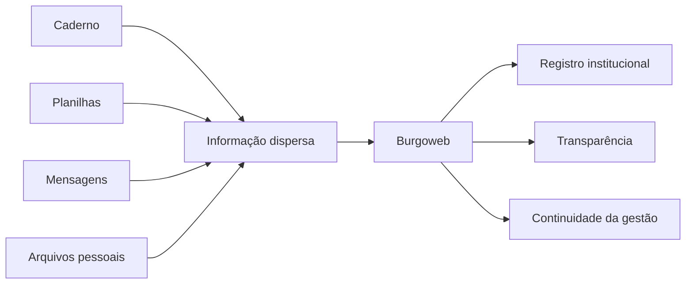

# Identidade e propósito

## Nome de trabalho

**Burgoweb**.

“Burgo” remete a uma comunidade organizada em torno de espaços, recursos, regras e interesses comuns. “Web” comunica o ambiente digital no qual a comunidade administra e acompanha suas informações.

### Interpretação pretendida

> A comunidade condominial organizada em um espaço digital simples, acessível e transparente.

O nome permanece como candidato principal, não como decisão jurídica definitiva. Antes do lançamento deverão ser realizadas busca de anterioridade, análise das classes aplicáveis, verificação de domínios e avaliação de variantes fonéticas e gráficas.

## Natureza do produto

Produto web independente para gestão administrativa, acompanhamento financeiro e transparência de condomínios com pouca ou nenhuma estrutura de gestão.

## Propósito

> Democratizar o acesso à gestão condominial organizada, permitindo que qualquer síndico registre, acompanhe e compartilhe informações relevantes com simplicidade, rastreabilidade e transparência.

## Visão

Tornar-se o registro institucional digital do condomínio: um ambiente no qual informações, documentos, decisões, responsabilidades e histórico permaneçam acessíveis independentemente das pessoas que ocupem temporariamente a administração.

## Missão

Ajudar condomínios sem estrutura administrativa a organizar sua rotina, acompanhar gastos, preservar documentos, preparar informações para terceiros e prestar contas de maneira compreensível.

## Promessa central

> Organize o condomínio, acompanhe os gastos e preste contas com transparência, gratuitamente.

## Categoria proposta

**Plataforma gratuita de organização e transparência condominial.**

A expressão “ERP condominial” não deve ser usada como categoria inicial, pois cria expectativa de contabilidade, folha, cobrança e automação integral desde o primeiro momento.

## Público inicial

- síndicos moradores;
- síndicos profissionais em início de atividade;
- condomínios autogeridos;
- pequenas estruturas administrativas;
- condomínios que contam com contador ou escritório de folha externo, mas não possuem plataforma integrada.

O foco independe de o condomínio ser vertical, horizontal, residencial, comercial ou misto. O critério prioritário é a falta de estrutura administrativa organizada.

## Princípios de produto

1. **Simplicidade antes de abrangência.**
2. **Transparência como padrão para assuntos coletivos.**
3. **Privacidade e acesso mínimo necessário para dados pessoais ou restritos.**
4. **Registro único, múltiplos usos.**
5. **Histórico pertencente ao condomínio.**
6. **Adoção progressiva e valor antes do cadastro completo.**
7. **Uso móvel quando o contexto justificar.**
8. **Integração com profissionais externos sem substituí-los inicialmente.**
9. **Portabilidade dos dados e ausência de aprisionamento comercial.**
10. **Monetização sem comprometer neutralidade ou confiança.**

## Personalidade da marca

- clara;
- confiável;
- comunitária;
- prática;
- acessível;
- responsável;
- imparcial.

## Tom de voz

O Burgoweb deverá falar de forma simples e direta, evitando linguagem contábil, jurídica ou tecnológica desnecessária. Deve orientar sem infantilizar e informar sem burocratizar.

## Assinaturas provisórias

### Principal

> Seu condomínio organizado e transparente.

### Funcional

> Da rotina do síndico à transparência para os moradores.

### Institucional

> A gestão muda. O histórico do condomínio permanece.

## O que a marca deve evitar

- aparência de sistema contábil complexo;
- promessa de solução completa para qualquer condomínio;
- comunicação centrada apenas no síndico;
- imagem de rede social de vizinhos;
- associação entre transparência e exposição indiscriminada;
- publicidade que pareça recomendação neutra.
