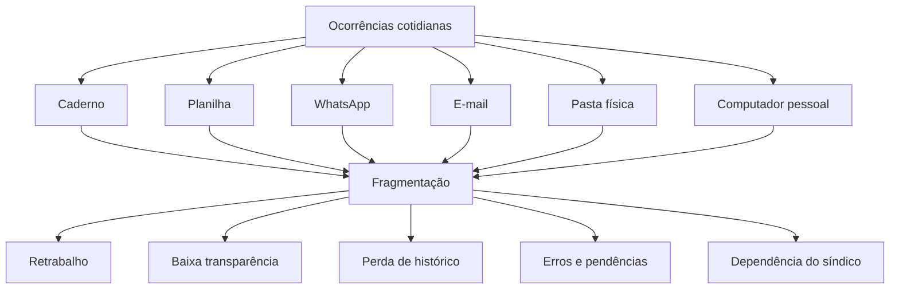
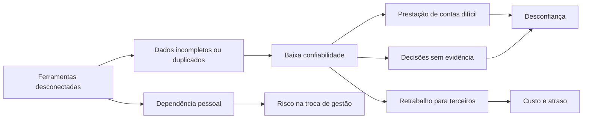
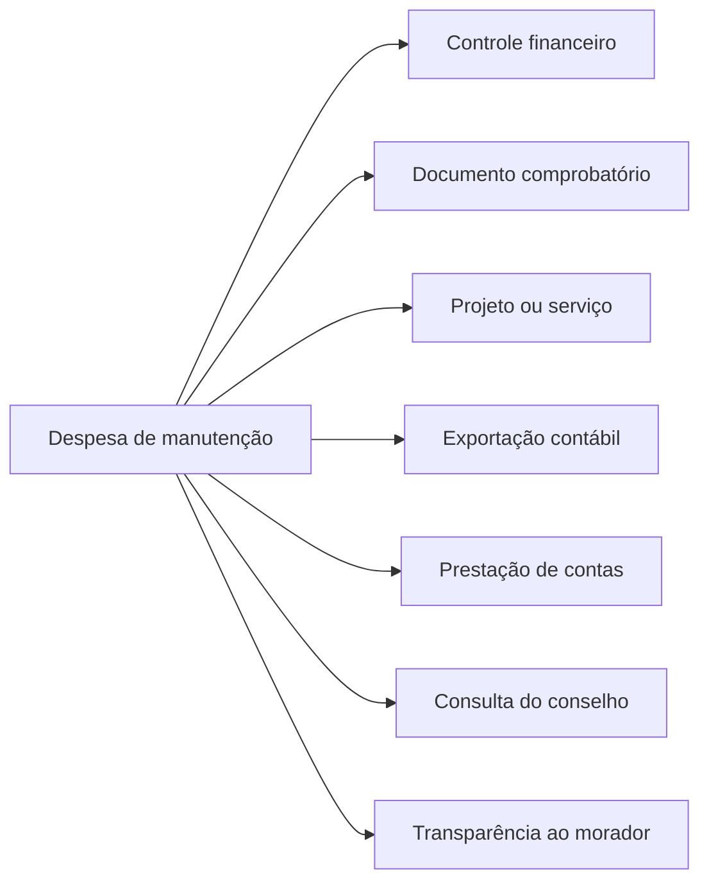

# Problema e contexto do condomínio

## Declaração do problema

Condomínios sem estrutura administrativa dependem de pessoas e ferramentas desconectadas para controlar atividades, finanças, funcionários, documentos, projetos e comunicações.

Essa forma de gestão dificulta a prestação de contas, gera retrabalho para síndicos e profissionais externos, reduz a visibilidade dos moradores e coloca em risco a continuidade administrativa quando ocorre mudança de gestão.

> O problema central não é apenas a ausência de software. É a ausência de um registro institucional único, simples e acessível.

## Contexto operacional

## Problemas estruturantes

### 1. Informação dispersa

Dados ficam distribuídos entre cadernos, planilhas, mensagens, e-mails, pastas, computadores particulares e documentos mantidos por terceiros.

**Efeito:** ninguém possui uma visão completa, atualizada e verificável.

### 2. Gestão dependente da pessoa do síndico

Processos, documentos, contatos, acessos e conhecimento permanecem sob controle pessoal.

**Efeito:** a troca de gestão pode provocar perda de informação e descontinuidade.

### 3. Prestação de contas trabalhosa

A administração precisa reunir documentos, reconstruir acontecimentos e montar relatórios manualmente.

**Efeito:** uma gestão correta pode parecer opaca por falta de informação acessível.

### 4. Baixa visibilidade dos gastos

Despesas podem ser registradas sem análise por categoria, fornecedor, projeto, orçamento, recorrência ou histórico.

**Efeito:** variações, desperdícios e compromissos são percebidos tarde.

### 5. Retrabalho contábil

Documentos chegam ao contador por canais e formatos diferentes, muitas vezes sem identificação, competência ou classificação consistente.

**Efeito:** digitação repetida, atrasos e solicitações de correção.

### 6. Eventos de folha controlados informalmente

Horas extras, faltas, plantões, substituições e afastamentos podem permanecer em papel ou mensagens.

**Efeito:** risco de erro operacional e trabalhista.

### 7. Obras sem visão integrada

Necessidade, propostas, decisão, contrato, cronograma, evidências e pagamentos ficam separados.

**Efeito:** o condomínio conhece parte do gasto, mas não acompanha adequadamente a entrega.

### 8. Comunicação sem memória institucional

Mensageiros são eficientes para conversa, mas inadequados como repositório oficial.

**Efeito:** decisões e orientações perdem contexto ou desaparecem entre mensagens.

### 9. Transparência reativa

Moradores dependem de solicitações individuais para obter informações coletivas.

**Efeito:** sobrecarga do síndico e percepção de opacidade.

### 10. Conhecimento que não pertence ao condomínio

Contratos, rotinas, contatos e pendências podem sair junto com a gestão anterior.

**Efeito:** cada nova administração precisa reconstruir parte da operação.

## Cadeia de causas e consequências

## Oportunidade de produto

Criar um sistema que capture o acontecimento uma única vez e reutilize o registro em diferentes contextos.

Exemplo:

## Hipótese fundamental

Síndicos adotarão uma plataforma gratuita quando ela reduzir o trabalho diário de organização e prestação de contas. Moradores apoiarão sua utilização quando ela oferecer acesso simples, contínuo e confiável às informações coletivas.

## Limites do problema

O Burgoweb não pretende resolver inicialmente:

- toda a contabilidade do condomínio;
- todos os processos de folha;
- movimentação bancária completa;
- controle de acesso físico;
- administração jurídica;
- responsabilidade técnica por obras;
- todos os conflitos de convivência.

O primeiro problema a ser resolvido é a **organização e continuidade da informação administrativa**.
