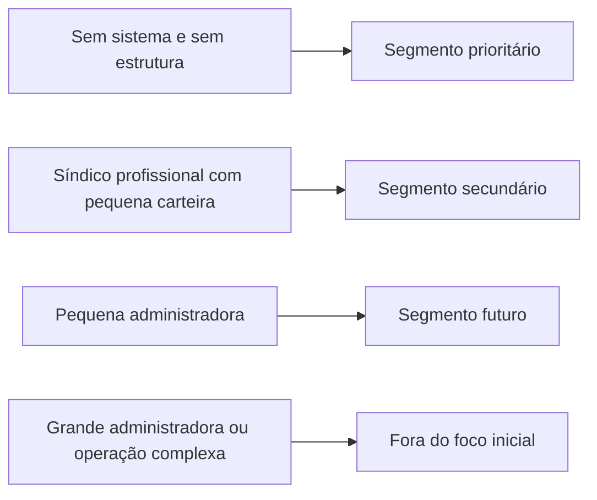
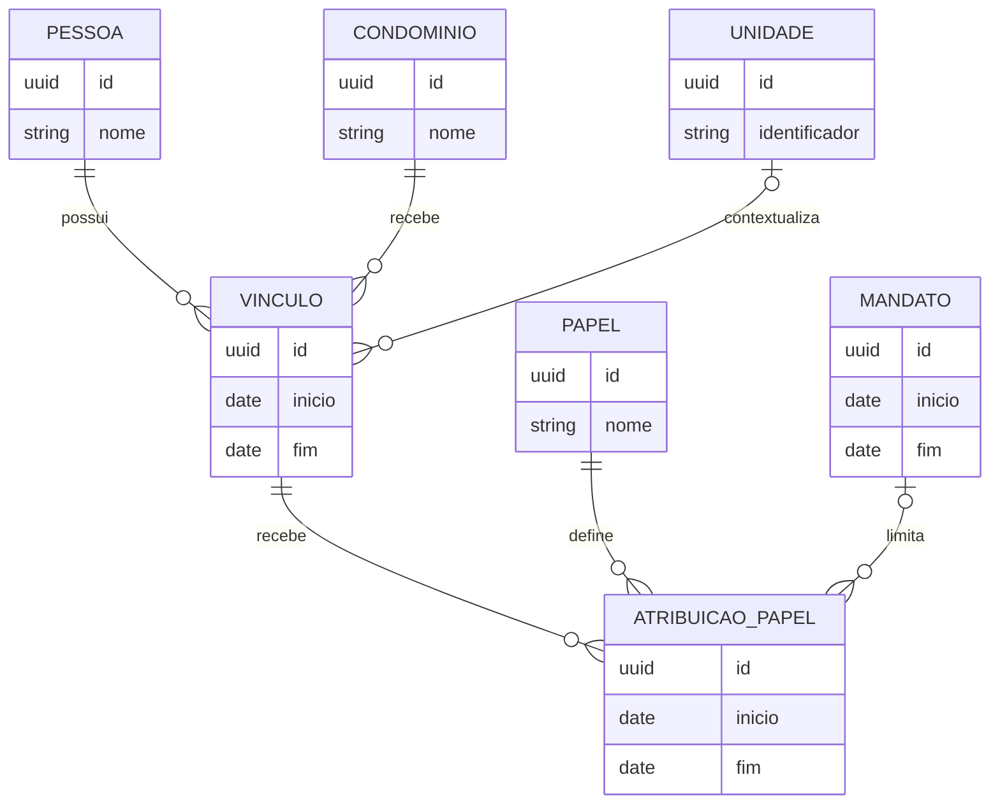

# Segmentos e personas

## Princípio de segmentação

O mercado deve ser segmentado principalmente pelo **grau de estrutura administrativa**, não apenas pelo tipo físico do condomínio.

## Segmento prioritário

### Condomínios autogeridos ou pouco estruturados

Características frequentes:

- gestão realizada por síndico morador;
- uso de caderno, planilha, mensagens e pastas;
- contador ou folha terceirizados;
- baixa padronização;
- dificuldade de prestação de contas;
- pouca continuidade entre mandatos;
- ausência de portal institucional.

## Segmento secundário

### Síndicos profissionais com pequena carteira

Necessitam separar condomínios, padronizar processos e crescer sem ampliar imediatamente a equipe.

## Segmento futuro

### Pequenas administradoras

Demandam equipes, carteiras, cobrança, conciliação, integrações, fluxos de aprovação e maior automação.

## Unidade de valor

- **Cliente institucional:** condomínio.
- **Adotante inicial:** síndico ou responsável administrativo.
- **Beneficiários:** moradores, proprietários, conselho, funcionários, contador, folha, prestadores e futuras gestões.

## Modelo conceitual de participação

> Pessoa, usuário, vínculo e papel são conceitos distintos. Uma pessoa pode acumular papéis e exercer funções diferentes ao longo do tempo.

## Personas prioritárias

### Márcia — síndica voluntária

**Perfil:** proprietária e moradora, eleita por falta de candidatos, administra à noite ou nos fins de semana.

**Necessidades:** organizar despesas e documentos; acompanhar compromissos; responder aos moradores; preparar prestação de contas; deixar histórico para a próxima gestão.

**Objetivo:** administrar sem precisar se tornar especialista.

### Ana — conselheira

**Perfil:** participa da fiscalização, mas não da operação cotidiana.

**Necessidades:** acompanhar gastos, consultar comprovantes, registrar dúvidas e verificar decisões.

**Objetivo:** fiscalizar continuamente sem interferir na administração.

### Carlos — proprietário interessado

**Perfil:** deseja compreender como o dinheiro coletivo é usado.

**Necessidades:** acessar despesas, decisões, documentos e andamento de projetos em linguagem compreensível.

**Objetivo:** obter respostas sem solicitar cada informação ao síndico.

### Júlia — moradora locatária

**Perfil:** interessa-se pela rotina e pelas regras que afetam a unidade onde vive.

**Necessidades:** comunicados, manutenções, regras, ocorrências e retorno sobre demandas.

**Objetivo:** acessar as informações necessárias para viver bem no condomínio.

### João — funcionário operacional

**Perfil:** trabalha diariamente no condomínio e utiliza principalmente o celular.

**Necessidades:** registrar tarefas, ocorrências, fotografias, horas e presença de prestadores.

**Objetivo:** informar o trabalho realizado sem operar um sistema administrativo complexo.

### Patrícia — assistente contábil

**Perfil:** recebe documentos de vários condomínios.

**Necessidades:** dados organizados por competência, categoria e documento; exportação; indicação de pendências.

**Objetivo:** reduzir redigitação e solicitações de correção.

### Roberto — operador de folha

**Perfil:** processa eventos trabalhistas enviados pelos condomínios.

**Necessidades:** horas e eventos consolidados, aprovados e exportáveis.

**Objetivo:** receber informação confiável dentro do prazo.

### Fernanda — prestadora

**Perfil:** fornece manutenção, engenharia ou outro serviço.

**Necessidades:** receber escopo, enviar proposta, registrar andamento e anexar evidências.

**Objetivo:** interagir de forma estruturada sem acessar informações internas.

## Persona de expansão

### Eduardo — síndico profissional iniciante

**Necessidades:** alternar entre condomínios, evitar mistura de dados, reutilizar modelos, acompanhar pendências e demonstrar profissionalismo.

**Objetivo:** aumentar a carteira sem multiplicar o trabalho operacional.

## Arquétipos de acesso

| Arquétipo | Função |
|---|---|
| Administrador eleito | Administra e responde pelo condomínio |
| Administrador delegado | Executa funções atribuídas |
| Fiscalizador | Analisa, questiona e emite parecer |
| Deliberante | Participa de decisões |
| Morador | Consulta e interage |
| Trabalhador interno | Registra tarefas, horas e ocorrências |
| Especialista externo | Recebe ou fornece dados específicos |
| Prestador | Atua em serviço ou projeto delimitado |
| Auditor | Consulta o histórico sem modificá-lo |

## Antipersonas

- **Síndico opaco:** deseja usar o sistema apenas para controle pessoal e evitar transparência coletiva.
- **Morador fiscalizador abusivo:** exige acesso a dados pessoais ou trabalhistas sob pretexto de transparência.
- **Anunciante oportunista:** pretende explorar dados internos para segmentação ou abordagem individual.
- **Prestador com acesso excessivo:** deseja visualizar orçamento, propostas concorrentes ou informações internas.
- **Administradora que aprisiona dados:** busca impedir que o condomínio exporte seu próprio histórico.
