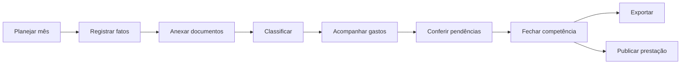
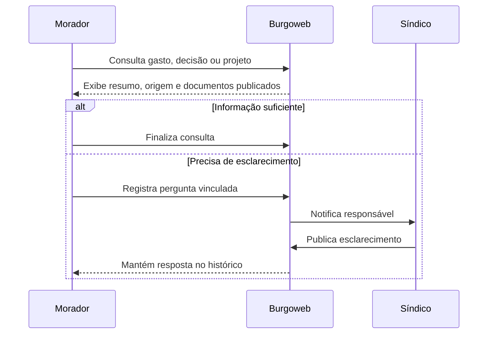
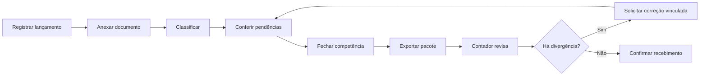
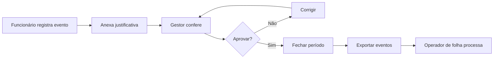
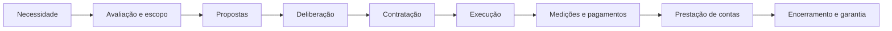
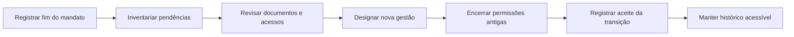
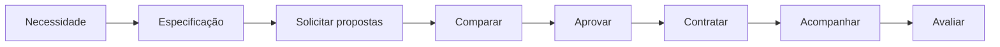
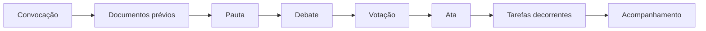

# Necessidades e jornadas

## Necessidades estruturantes

| Necessidade | Resultado esperado |
|---|---|
| Organizar a operação | Centralizar compromissos, registros e documentos |
| Controlar finanças | Saber o que entrou, saiu, venceu e foi pago |
| Prestar contas | Demonstrar gastos e decisões com evidências |
| Preservar histórico | Manter informação entre gestões |
| Apoiar terceiros | Entregar dados estruturados para contabilidade e folha |
| Acompanhar obras | Relacionar aprovação, execução e pagamentos |
| Informar moradores | Disponibilizar informações sem sobrecarregar o síndico |
| Controlar acessos | Expor o necessário e proteger dados restritos |

## Jornada 1 — Entrada do condomínio

### Objetivo

Começar a usar o sistema sem reconstruir previamente toda a história do condomínio.

### Momento de valor

A síndica registra uma despesa com comprovante e consegue disponibilizá-la em uma prestação de contas compreensível.

### Requisitos derivados

- cadastro progressivo;
- importação simples;
- convite por link, e-mail ou código;
- checklist de implantação;
- modelos iniciais;
- dados de exemplo;
- correção sem perda de histórico.

## Jornada 2 — Rotina mensal do síndico

### Resultado esperado

Chegar ao fim do mês sem procurar documentos ou reconstruir os acontecimentos.

### Pendências que o produto deve evidenciar

- lançamento sem documento;
- vencimento não tratado;
- pagamento pendente;
- categoria não definida;
- informação não enviada ao contador;
- horas sem aprovação;
- prestação não publicada.

## Jornada 3 — Transparência para o morador

### Níveis de informação

1. **Coletiva:** visível aos usuários autorizados do condomínio.
2. **Administrativa restrita:** visível a funções determinadas.
3. **Pessoal ou trabalhista:** acesso estritamente necessário.

### Momento de valor

O morador encontra sozinho a resposta para uma dúvida comum e confia na origem da informação.

## Jornada 4 — Dados para contabilidade

### Dados mínimos

- competência;
- vencimento;
- pagamento;
- natureza;
- categoria;
- fornecedor ou origem;
- descrição;
- valor;
- forma de pagamento;
- projeto ou centro de custo;
- documento;
- situação;
- responsável.

### Limite

O Burgoweb estrutura e exporta dados, mas não realiza inicialmente escrituração, cálculo tributário ou obrigação acessória.

## Jornada 5 — Eventos para folha

### Eventos iniciais

- horas extras;
- faltas;
- atrasos;
- plantões;
- substituições;
- férias;
- afastamentos;
- feriados;
- adicional noturno;
- compensações.

### Limite

Não calcular folha, encargos ou regras sindicais no núcleo inicial.

## Jornada 6 — Obra ou projeto

### Relações indispensáveis

- decisão e orçamento aprovado;
- fornecedor e contrato;
- etapa e evidência;
- pagamento e entrega;
- alteração de escopo e justificativa;
- conclusão e garantia.

## Jornada 7 — Troca de gestão

### Resultado esperado

O novo síndico inicia o mandato conhecendo compromissos, documentos, contratos, obras e pendências sem depender da memória da gestão anterior.

## Jornadas complementares

### Ocorrência

### Contratação

### Assembleia futura

## Priorização das jornadas

### Núcleo

1. entrada do condomínio;
2. rotina mensal;
3. transparência e consulta;
4. preparação contábil;
5. troca de gestão.

### Segunda camada

6. horas e eventos de folha;
7. projetos e obras;
8. tarefas e ocorrências;
9. fornecedores e contratos.

### Futuro

10. assembleias virtuais;
11. reuniões híbridas;
12. boletos e integração bancária;
13. leilão reverso;
14. marketplace;
15. multiconomínio avançado.
