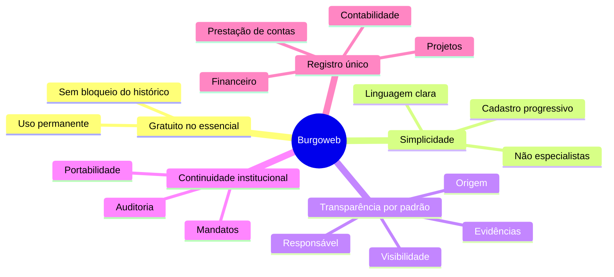

# Proposta de valor e diferenciação

## Proposta de valor central

> O Burgoweb é uma plataforma gratuita que ajuda condomínios sem estrutura administrativa a organizar sua gestão, acompanhar gastos, preservar documentos e oferecer transparência aos moradores, sem exigir conhecimento especializado.

## Benefícios

### Funcional

Centralizar informações administrativas, financeiras e documentais em um ambiente estruturado e acessível.

### Emocional

Reduzir a insegurança do síndico e aumentar a confiança dos moradores.

### Institucional

Preservar o histórico do condomínio independentemente das pessoas que ocupem temporariamente sua administração.

## Posicionamento

Para condomínios que ainda administram suas atividades com cadernos, planilhas, mensagens e arquivos dispersos, o Burgoweb é uma plataforma gratuita de organização e transparência condominial.

Diferentemente de ferramentas genéricas, oferece processos preparados para a realidade condominial. Diferentemente de plataformas profissionais complexas, pode ser adotado gradualmente, sem conhecimento especializado e sem custo obrigatório para usar o núcleo essencial.

## Pilares de diferenciação

## Comparação com alternativas

| Critério | Caderno e planilha | Mensagens e arquivos | Administradora | Sistema profissional | Burgoweb proposto |
|---|---:|---:|---:|---:|---:|
| Custo inicial baixo | Alto | Alto | Baixo | Médio | Alto |
| Facilidade imediata | Alta | Alta | Média | Média | Alta |
| Estrutura condominial | Baixa | Baixa | Alta | Alta | Alta e simplificada |
| Transparência contínua | Baixa | Baixa | Variável | Alta | Alta por padrão |
| Histórico institucional | Baixo | Baixo | Variável | Alto | Pilar central |
| Apoio contábil | Baixo | Baixo | Alto | Alto | Intermediário |
| Cobrança integrada | Não | Não | Frequente | Frequente | Futuro |
| Adoção gradual | Alta | Alta | Baixa | Variável | Alta |
| Uso sem especialista | Alta | Alta | Não aplicável | Variável | Objetivo central |
| Portabilidade | Manual | Manual | Variável | Variável | Obrigatória |

## Estratégia frente a cada alternativa

### Caderno e planilha

> Mais organizado que a planilha, sem a complexidade de um ERP.

O Burgoweb precisa preservar baixo custo e liberdade, oferecendo estrutura pronta, anexos relacionados, colaboração e histórico.

### WhatsApp, e-mail e arquivos

> Converse onde for conveniente; registre o que importa no Burgoweb.

O produto não precisa eliminar mensageiros, mas deve impedir que eles sejam o único repositório administrativo.

### Administradora tradicional

> Use sozinho ou em conjunto com os profissionais que já atendem o condomínio.

O Burgoweb não deve prometer substituir universalmente uma administradora.

### Sistemas profissionais

O Burgoweb não concorrerá inicialmente por maior cobertura funcional. O espaço pretendido fica entre ferramentas genéricas gratuitas e plataformas profissionais pagas.

## Propostas por público

| Público | Proposta específica |
|---|---|
| Síndico | Organize despesas, documentos, tarefas e prestações sem várias planilhas |
| Morador | Acompanhe gastos, decisões e obras sem pedir cada informação |
| Conselho | Fiscalize continuamente com registros e evidências |
| Contador | Receba lançamentos e comprovantes organizados e exportáveis |
| Funcionário | Registre tarefas, ocorrências e horas pelo celular |
| Nova gestão | Receba histórico, documentos e pendências organizados |

## Diferenciações que não devem ser alegadas

- “o sistema mais completo”;
- “a solução definitiva”;
- “o único sistema transparente”;
- “o primeiro sistema gratuito”;
- “substituto completo da administradora”;
- “ERP completo para condomínios”.

## Razões para acreditar

- registros relacionados a documentos e responsáveis;
- histórico rastreável;
- diferentes níveis de acesso;
- prestação de contas derivada da rotina;
- visualização compreensível;
- exportação para terceiros;
- adoção progressiva;
- núcleo essencial gratuito.
