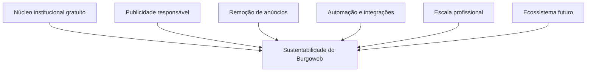
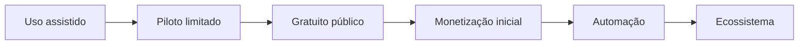

# Escopo e modelo de negócio

## Modelo proposto

O Burgoweb adotará um modelo **free-first**.

O núcleo gratuito deverá permanecer útil e suficiente para o público prioritário. A monetização ocorrerá por conveniência, automação, escala, integrações e publicidade responsável, não pela retirada artificial de funções institucionais essenciais.

> O condomínio não deverá pagar para obter organização básica, preservar seu histórico ou exercer transparência.

## Estrutura econômica

## Núcleo gratuito permanente

### Administração

- condomínio, blocos, unidades e áreas;
- pessoas, vínculos, papéis e mandatos;
- tarefas e compromissos básicos;
- fornecedores;
- comunicados;
- histórico.

### Financeiro

- receitas e despesas;
- vencimentos;
- pagamentos manuais;
- comprovantes;
- categorias;
- acompanhamento mensal;
- orçamento básico;
- projetos ou centros de custo;
- prestação de contas;
- exportação genérica.

### Transparência

- portal do morador;
- informações coletivas;
- documentos publicados;
- projetos;
- decisões;
- origem, data e responsável;
- controle de visibilidade.

### Continuidade

- mandatos;
- troca de gestão;
- expiração de permissões;
- checklist de transição;
- auditoria básica;
- exportação dos dados.

### Apoio externo

- fechamento por competência;
- documentos relacionados;
- exportação contábil genérica;
- acesso restrito do contador;
- eventos básicos de folha em etapa posterior.

## Funcionalidades potencialmente pagas

### Conveniência

- remoção de publicidade;
- armazenamento adicional;
- identidade visual;
- suporte prioritário.

### Automação financeira

- importação bancária;
- conciliação;
- boletos e Pix;
- baixa automática;
- cobrança e inadimplência;
- notificações configuradas.

### Integrações

- conectores contábeis;
- conectores de folha;
- APIs;
- webhooks;
- assinatura eletrônica;
- videoconferência.

### Profissionalização

- multiconomínio;
- painel consolidado;
- equipes;
- fluxos de aprovação;
- relatórios de carteira;
- marca própria;
- operações em lote.

### Recursos avançados

- projetos e medições;
- assembleias digitais;
- inteligência e análise;
- extração de dados de documentos;
- previsões e alertas.

## Publicidade

### Princípios

- identificação inequívoca;
- separação entre anúncio e informação administrativa;
- ausência de anúncios em documentos oficiais;
- ausência de segmentação baseada em dados pessoais ou financeiros internos;
- neutralidade em comparações de fornecedores;
- opção futura de remoção.

### Contextos aceitáveis

- página inicial;
- conteúdo educativo;
- diretório de serviços;
- área específica de fornecedores;
- rodapé do portal;
- ofertas solicitadas pelo usuário.

### Contextos proibidos

- prestação de contas;
- atas;
- relatórios de auditoria;
- exportações;
- votações;
- telas de dados trabalhistas;
- ocorrências privadas;
- comprovantes;
- comparação de propostas.

### Dados proibidos para segmentação

- renda;
- salário;
- inadimplência individual;
- dados bancários;
- ocorrências;
- dados de saúde;
- dados trabalhistas;
- conteúdo de documentos;
- histórico de votação;
- conflitos internos;
- dados de crianças.

## Pagadores potenciais

| Pagador | Valor recebido |
|---|---|
| Condomínio | Sem anúncios, automações e integrações |
| Síndico profissional | Carteira e ganho de escala |
| Administradora | Equipes, fluxos, marca e APIs |
| Escritório contábil | Integração e processamento em lote |
| Escritório de folha | Eventos padronizados e integração |
| Fornecedor | Diretório, oportunidade ou ferramenta de proposta |
| Parceiro | Integração ou serviço complementar |

O morador individual não deve ser o pagador principal, pois isso criaria assimetria de acesso dentro do condomínio.

## Unidade de cobrança futura

Preferência por cobrança **por condomínio por mês**, com faixas amplas de porte. Cobrar por usuário pode desestimular convites e transparência.

## Leilão reverso futuro

O Burgoweb deve atuar como plataforma de processo, não como parte contratante ou garantidor da execução.

## Limites do produto

O Burgoweb não será inicialmente:

- sistema contábil;
- sistema de folha;
- banco ou instituição de pagamento;
- garantidor de inadimplência;
- sistema oficial de ponto;
- administradora;
- escritório jurídico;
- responsável técnico por obras;
- certificador das contas;
- marketplace com garantia de execução.

## Estratégia de entrada

### Ordem sugerida de monetização

1. remoção de anúncios;
2. armazenamento adicional;
3. multiconomínio;
4. integrações contábeis;
5. automações financeiras;
6. diretório patrocinado de fornecedores.

## Métrica principal

> Percentual de condomínios ativos que concluem o fechamento mensal e publicam a prestação de contas.

Essa métrica combina valor administrativo e transparência.
