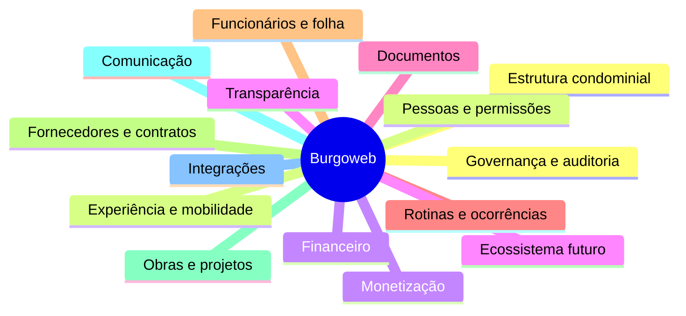
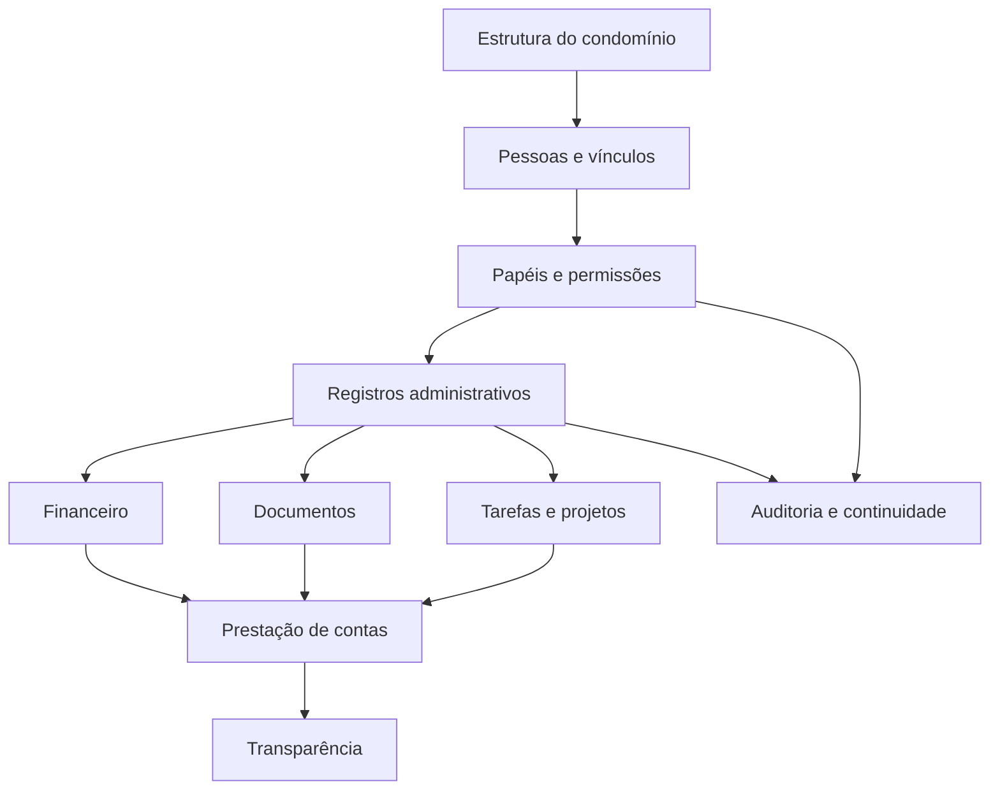
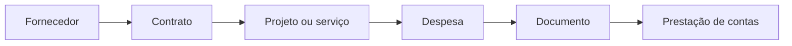
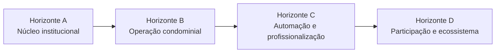

# Mapa de capacidades

O mapa descreve **o que o produto deverá ser capaz de fazer**, sem definir telas, tecnologia ou sequência de implementação.

## Visão geral

## 1. Identidade e estrutura condominial

### Essenciais

- cadastro do condomínio;
- tipo residencial, comercial ou misto;
- endereço;
- blocos, torres, quadras, lotes e unidades;
- áreas comuns;
- exercício financeiro;
- documentos institucionais;
- configuração progressiva.

### Posteriores

- empreendimentos relacionados;
- associações e loteamentos;
- estruturas complexas;
- identidade visual;
- domínio próprio.

## 2. Pessoas, vínculos e permissões

### Essenciais

- pessoas;
- vínculo com condomínio ou unidade;
- proprietário, morador, locatário e representante;
- início e fim do vínculo;
- papéis acumuláveis;
- convites;
- revogação;
- mandatos;
- especialistas externos;
- visibilidade por função.

### Posteriores

- procurações;
- representação em assembleias;
- equipes de administradoras;
- alçadas;
- autenticação corporativa.

## 3. Gestão financeira

### Essenciais

- receitas e despesas;
- competência, vencimento e pagamento;
- categorias;
- fornecedor ou origem;
- comprovantes;
- projeto ou centro de custo;
- recorrência;
- previsto e realizado;
- pendências;
- fechamento;
- comparação mensal;
- exportação.

### Posteriores

- rateios;
- fundos;
- parcelamentos;
- contas bancárias;
- extratos;
- conciliação;
- boletos e Pix;
- inadimplência;
- orçamento e fluxo de caixa avançados.

## 4. Prestação de contas e transparência

### Essenciais

- prestação mensal;
- receitas e despesas;
- comparação de períodos;
- explicação de variações;
- documentos relacionados;
- publicação;
- público e visibilidade;
- histórico;
- estado preliminar ou consolidado;
- perguntas e esclarecimentos.

### Posteriores

- parecer do conselho;
- aprovação formal;
- relatórios anuais;
- indicadores;
- publicação automática configurável.

## 5. Documentos e memória institucional

### Essenciais

- armazenamento;
- classificação;
- associação a registros;
- pesquisa;
- visibilidade;
- autoria e data;
- versão;
- exclusão lógica rastreada;
- exportação;
- preservação entre gestões.

### Posteriores

- OCR;
- extração de dados;
- assinatura;
- classificação assistida;
- retenção configurável;
- versionamento avançado.

## 6. Rotinas, tarefas e ocorrências

### Essenciais

- tarefas;
- responsável;
- prazo e prioridade;
- situação;
- evidências;
- recorrência;
- ocorrências;
- classificação;
- providência;
- conclusão;
- histórico.

### Posteriores

- ordens de serviço;
- SLA;
- catálogo;
- automações;
- manutenção preventiva;
- checklists;
- sensores.

## 7. Funcionários e apoio à folha

### Essenciais

- funcionários;
- acesso restrito;
- horas extras;
- faltas e atrasos;
- plantões e substituições;
- férias e afastamentos;
- justificativa;
- aprovação;
- fechamento;
- exportação.

### Posteriores

- escalas;
- banco de horas;
- ponto;
- integração com folha;
- regras configuráveis;
- benefícios e treinamentos.

## 8. Fornecedores, contratos e compras

### Essenciais

- cadastro e contatos;
- classificação;
- documentos;
- contratos;
- vigência;
- despesas relacionadas;
- propostas;
- avaliação interna.

### Posteriores

- solicitação de cotação;
- comparação;
- qualificação;
- aprovação;
- portal do fornecedor;
- concorrência eletrônica.

## 9. Obras, manutenção e projetos

### Essenciais

- iniciativa;
- justificativa;
- responsável;
- orçamento;
- aprovação;
- etapas;
- situação;
- custos;
- fotografias;
- fornecedor;
- ocorrências;
- comunicação aos moradores;
- conclusão e garantia.

### Posteriores

- cronograma;
- dependências;
- medições;
- alterações de escopo;
- curva financeira;
- riscos;
- diário de obra.

## 10. Comunicação e participação

### Essenciais

- comunicados;
- público;
- notificações;
- histórico;
- anexos;
- confirmação de leitura;
- vínculo com projeto, ocorrência ou decisão;
- perguntas estruturadas.

### Posteriores

- enquetes;
- pautas;
- reuniões híbridas;
- assembleias;
- votação e quórum;
- procurações;
- atas;
- gravação e transcrição.

## 11. Integrações e exportações

### Essenciais

- formatos abertos;
- documentos;
- lançamentos contábeis;
- eventos de folha;
- importação de planilhas;
- histórico de exportações;
- mapeamento de categorias;
- portabilidade.

### Posteriores

- APIs;
- webhooks;
- bancos;
- contabilidade;
- folha;
- mensageria;
- assinatura;
- videoconferência.

## 12. Governança, auditoria e continuidade

### Essenciais

- autoria;
- data e hora;
- histórico de alterações;
- vigência de papéis;
- encerramento de mandato;
- transferência de responsabilidade;
- pendências;
- preservação do histórico;
- acesso sensível;
- exportação integral.

### Posteriores

- quatro olhos;
- segregação de funções;
- retenção configurável;
- relatórios de conformidade;
- auditoria externa;
- alertas de anomalia.

## 13. Experiência, acessibilidade e mobilidade

### Essenciais

- interface responsiva;
- linguagem simples;
- orientação contextual;
- cadastro progressivo;
- pesquisa;
- notificações configuráveis;
- contraste;
- navegação por teclado;
- ícones com texto;
- confirmação de ações sensíveis;
- prevenção de erros.

### Prioridade móvel

- consulta;
- comunicação;
- fotografia;
- ocorrência;
- tarefa;
- aprovação;
- horas;
- acompanhamento de projeto.

### Prioridade desktop

- configuração;
- análise financeira;
- importação;
- fechamento;
- permissões;
- relatórios extensos.

## 14. Sustentabilidade e monetização

### Essenciais

- núcleo gratuito;
- publicidade identificada;
- contextos proibidos;
- consumo e limites responsáveis;
- remoção de anúncios;
- métricas de uso;
- proteção dos dados de monetização.

### Posteriores

- planos;
- cobrança recorrente;
- armazenamento adicional;
- add-ons;
- parceiros;
- fornecedores patrocinados;
- planos profissionais.

## 15. Ecossistema futuro

- sala virtual;
- reunião híbrida;
- assembleia;
- votação;
- leilão reverso;
- marketplace;
- diretório;
- reputação;
- inteligência e análises.

## Dependências principais

## Relações transversais

## Horizontes de evolução

### Horizonte A — Núcleo institucional

Estrutura, pessoas, financeiro básico, documentos, prestação de contas, transparência, exportação, continuidade e auditoria.

### Horizonte B — Operação condominial

Tarefas, ocorrências, funcionários, fornecedores, contratos, manutenção, obras e projetos.

### Horizonte C — Automação e profissionalização

Banco, cobrança, conciliação, integrações, multiconomínio, equipes, APIs e relatórios avançados.

### Horizonte D — Participação e ecossistema

Assembleias, reuniões, compras, leilão reverso, marketplace e inteligência.
