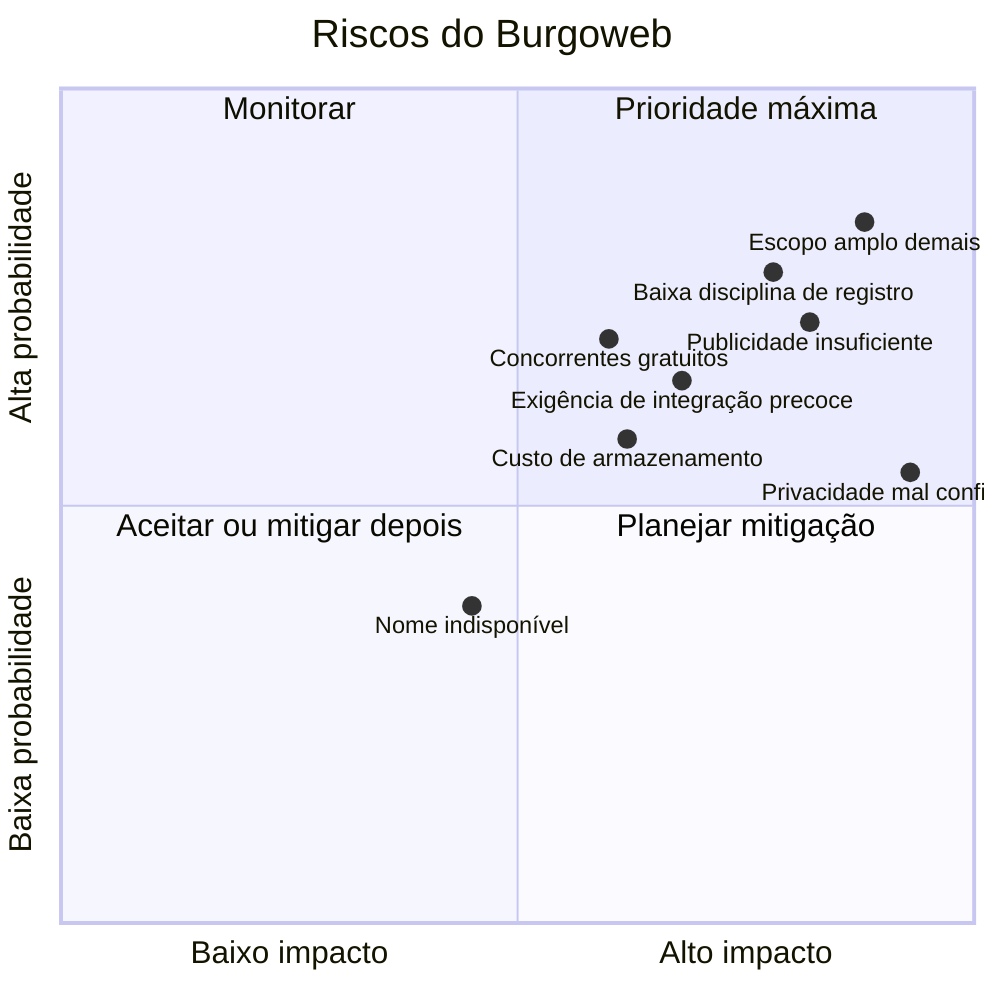
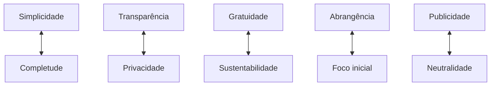

# Decisões, hipóteses e riscos

## Decisões tomadas

| ID | Tema | Decisão | Estado |
|---|---|---|---|
| DEC-001 | Marca | Produto independente | Aceita |
| DEC-002 | Nome | Burgoweb como candidato principal | Provisória |
| DEC-003 | Público | Condomínios sem estrutura organizada | Aceita |
| DEC-004 | Tipologia | Atender vertical, horizontal, comercial e misto por núcleo configurável | Aceita |
| DEC-005 | Modelo | Free-first | Aceita |
| DEC-006 | Financeiro | Registro e exportação; banco e conciliação depois | Aceita |
| DEC-007 | Transparência | Máxima para informação coletiva, com controle de acesso | Aceita |
| DEC-008 | Dados | Histórico pertence ao condomínio | Aceita |
| DEC-009 | Implementação | PRD, UX, arquitetura e backlog no VS Code com BMAD | Aceita |
| DEC-010 | Publicidade | Contextual, identificada, não intrusiva e sem perfilamento sensível | Aceita como princípio |

## Hipóteses de valor

| ID | Hipótese | Evidência necessária |
|---|---|---|
| HYP-001 | Gratuidade reduz a barreira para experimentar | Conversão de visita para primeiro registro |
| HYP-002 | Transparência aumenta o apoio dos moradores | Convites aceitos e consultas recorrentes |
| HYP-003 | Registro contínuo reduz o esforço de fechamento | Tempo antes e depois do produto |
| HYP-004 | Síndico publica dados coletivos quando a privacidade está clara | Taxa de prestação publicada |
| HYP-005 | Contadores aceitam exportações configuráveis | Pilotos com escritórios reais |
| HYP-006 | Publicidade moderada é tolerada | Retenção e pesquisas de percepção |
| HYP-007 | Continuidade entre gestões é percebida como valor | Uso do checklist e transferência |
| HYP-008 | Há escala suficiente para sustentabilidade | Custo, uso e receita por condomínio |

## Hipóteses de usabilidade

- o usuário consegue obter valor antes de cadastrar toda a estrutura;
- o primeiro lançamento pode ser realizado sem treinamento formal;
- moradores compreendem visualizações simplificadas melhor que balancetes;
- o celular é suficiente para ocorrências, fotos, horas e consultas;
- o computador é preferível para configuração e fechamento;
- notificações configuráveis evitam que o sistema se torne tão ruidoso quanto um grupo de mensagens.

## Riscos estratégicos

### RSK-001 — Escopo excessivo

**Descrição:** tentar atender todos os módulos condominiais desde o início.

**Mitigação:** orientar o PRD pelo núcleo institucional e pelos horizontes de capacidade.

### RSK-002 — Baixa disciplina de registro

**Descrição:** o síndico experimenta o produto, mas volta à planilha ou ao mensageiro.

**Mitigação:** captura rápida, lembretes úteis, importação e valor perceptível no fechamento.

### RSK-003 — Transparência versus privacidade

**Descrição:** informação pessoal ou trabalhista é exposta indevidamente.

**Mitigação:** classificação de visibilidade, padrões seguros, acesso mínimo, auditoria e revisão jurídica.

### RSK-004 — Publicidade compromete confiança

**Descrição:** anúncios parecem recomendação ou utilizam dados incompatíveis com a finalidade do produto.

**Mitigação:** separação visual, regras públicas, segmentação contextual e áreas proibidas.

### RSK-005 — Sustentabilidade financeira insuficiente

**Descrição:** receita publicitária não cobre armazenamento, suporte e infraestrutura.

**Mitigação:** medir custo unitário cedo e validar remoção de anúncios, multiconomínio e integrações.

### RSK-006 — Complexidade legal futura

**Descrição:** assembleias, cobrança, dados trabalhistas ou marketplace criam responsabilidades adicionais.

**Mitigação:** implementar por fases, obter revisão especializada e preservar limites explícitos.

### RSK-007 — Generalização por tipo de condomínio

**Descrição:** modelo físico baseado apenas em edifícios e apartamentos impede uso por outros condomínios.

**Mitigação:** modelar estruturas genéricas: agrupamentos, unidades e áreas.

### RSK-008 — Aprisionamento acidental

**Descrição:** documentos ou dados se tornam difíceis de exportar.

**Mitigação:** formatos abertos e exportação integral como capacidade institucional.

## Tensões de produto

## Perguntas a validar no Product Brief e PRD

1. Qual é o menor conjunto que produz um fechamento mensal útil?
2. Que informação deve nascer publicada e qual deve exigir publicação explícita?
3. Qual é a estrutura mínima de unidade e vínculo que atende diferentes condomínios?
4. Como será comprovada a autoridade para cadastrar um condomínio?
5. Como ocorrerá a transferência de controle entre síndicos?
6. Qual franquia de armazenamento é sustentável?
7. Quais formatos de exportação os contadores realmente utilizam?
8. Como evitar que publicidade influencie seleção de fornecedores?
9. Quais métricas demonstram confiança, além de uso?
10. Quais recursos devem ser excluídos explicitamente do primeiro PRD?
