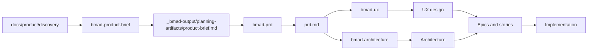
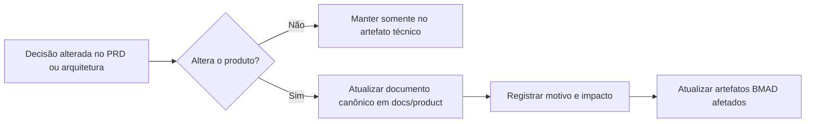

# Handoff para BMAD no VS Code

## Objetivo

Usar este discovery como fonte para os workflows formais do BMAD sem repetir a ideação e sem transformar os documentos permanentes em artefatos descartáveis.

## Estrutura recomendada do repositório

```text
burgoweb/
├── _bmad/                              # Instalado e gerenciado pelo BMAD
├── _bmad-output/
│   ├── planning-artifacts/             # Product Brief, PRD, UX e arquitetura
│   ├── implementation-artifacts/       # Histórias, sprint e execução
│   └── project-context.md              # Regras técnicas após definição
├── docs/
│   └── product/
│       ├── README.md
│       └── discovery/                  # Este pacote: conhecimento permanente
├── src/                                # Definido posteriormente
└── README.md
```

## Por que usar `docs/product/discovery/`

- estes documentos registram intenção, racional de negócio, decisões e hipóteses duradouras;
- o BMAD trata `_bmad-output/planning-artifacts/` como área de artefatos de planejamento;
- Product Brief, PRD, UX e arquitetura podem evoluir, ser regenerados ou arquivados;
- a documentação canônica não deve ser sobrescrita por workflows;
- o diretório `docs/` permanece útil para pessoas, auditoria de decisões e onboarding.

## Fluxo recomendado



## Instalação sugerida

Na raiz do repositório:

```bash
npx bmad-method install
```

Selecione o módulo **BMad Method** e a integração compatível com o ambiente usado no VS Code.

## Primeiro workflow

Execute o workflow de Product Brief e indique como fontes todos os arquivos de:

```text
docs/product/discovery/
```

O resultado esperado deve ser salvo pelo BMAD em:

```text
_bmad-output/planning-artifacts/product-brief.md
```

## Instrução de contexto sugerida ao agente

```text
Use todos os documentos em docs/product/discovery como fontes canônicas da fase de análise.
Não reinicie a ideação do zero.
Identifique conflitos, lacunas e hipóteses não validadas antes de sintetizar o Product Brief.
Não introduza arquitetura, linguagem, framework ou backlog nesta etapa.
Preserve as decisões registradas e marque como hipótese tudo o que ainda depende de validação.
```

## Sequência de workflows

1. `bmad-product-brief` — sintetizar e criticar o discovery.
2. `bmad-prd` — criar requisitos, escopo e critérios de sucesso.
3. `bmad-ux` — fluxos, arquitetura de informação e experiência.
4. `bmad-architecture` ou workflow de arquitetura disponível na versão instalada.
5. `bmad-create-epics-and-stories` — decomposição após PRD e arquitetura.
6. `bmad-check-implementation-readiness` — gate antes da implementação.
7. `bmad-sprint-planning` e workflows de desenvolvimento.

## Regras de sincronização

Quando uma decisão mudar:



## `project-context.md`

Não preencher com decisões tecnológicas antes da arquitetura. Depois que stack, padrões e regras técnicas forem definidos, gerar ou revisar:

```text
_bmad-output/project-context.md
```

Esse arquivo deve orientar agentes de implementação, não substituir o discovery de produto.

## Critério de prontidão para sair do discovery

- proposta de valor coerente;
- segmentos e personas identificados;
- jornadas prioritárias descritas;
- núcleo gratuito e limites definidos;
- mapa de capacidades organizado por horizonte;
- hipóteses e riscos explícitos;
- decisões de tecnologia ainda não antecipadas.
